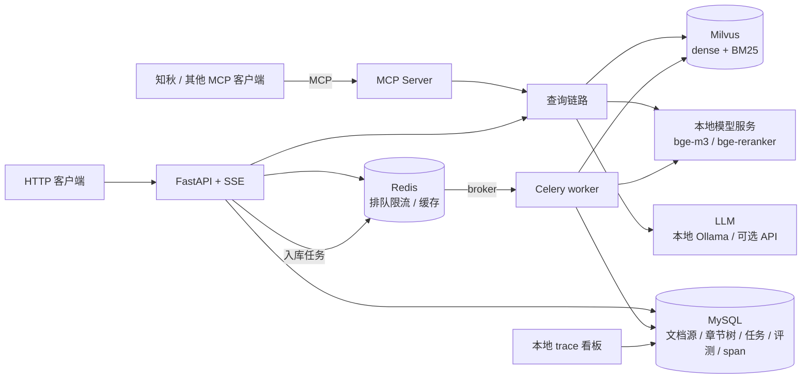

# 文渊（wenyuan）设计文档

> 日期：2026-11-01
> 一句话：面向多用户学习平台的 RAG 服务：**公共技术文档库 + 每个用户的私有资料库**，自带评测闭环和本地 trace 看板，通过 **MCP** 为学习助手知秋提供检索、问答和章节大纲。
> 更新：2026-11-01 晚，W1 跑通后调整：语料改为 DevDocs 为主体；新增私有资料库（理由见 1.2）。
> 更新：2026-11-01 夜，后端定位从“高并发”改为“RAG 服务的后端工程：慢请求、稀缺资源、多用户、数据一致性”（见 1.3）；模型改为本地优先、API 可选（见 3.3）。

---

## 1. 背景与目标

### 1.1 为什么这样做
- **目标**：一个每个设计取舍都讲得清的 RAG 服务：检索效果用评测数据说话，后端组件只为真实需求服务。
- **不从零造轮子，也不 fork 整个仓库**：以 LightRAG（HKUDS/LightRAG，4 万 star，MIT，commit `aaebfe1`）为母本剪枝，只拷贝低耦合、读得懂的模块；本地 trace 和 MCP 复用自己的知秋项目。
- **和知秋联动**：知秋是学习助手 Agent（讲解 → 自测 → FSRS 复习 → 学习计划），已有基于官方 MCP SDK 的客户端。本服务作为它的资料后端。
- **数据驱动迭代**：baseline → bad case 归因 → 针对性加模块 → 用指标验证效果，同时说明延迟和成本代价。

### 1.2 为什么要 RAG，而不是联网搜索
- **只基于公开文档，理由偏弱**：Google、带联网搜索的 LLM、Context7 这类文档 MCP 都能查到官方文档。
- **公开文档部分仍然成立的理由**：
  - 锁定学习者正在学的版本，避免不同版本的资料混在一起；
  - 回答必须有出处并经过校验，资料里没有就拒答，因为学习场景里学错比没学更糟；
  - 语料固定，结果可复现，才能做评测和消融；
  - 能提供章节结构，给知秋排学习计划、按章节出题，这是搜索做不到的。
- **真正不可替代的部分是私有资料**：学习者自己的笔记、讲义、电子书、公司内部规范，网上搜不到。所以本服务分两层：
  - **公共库**：官方文档，所有用户共享；
  - **私有库**：用户自己上传的资料，只有本人可见。
  - 检索时两层一起查，并按用户权限过滤。

### 1.3 后端定位：不是高并发，是“单请求重”
- **本项目没有真正的高并发需求**，也不这么宣称。传统高并发（秒杀、IM）是请求又多又轻，瓶颈在连接、数据库和锁；LLM 应用是请求又少又重，每个请求要几秒、占 GPU 或花钱，瓶颈在模型推理。
- 两者用的是同一套工具（缓存、队列、限流），解决的问题不同。本项目的后端工程针对的是：**慢请求、稀缺资源、多用户、数据一致性**。
- **部署方式**（同一套代码）：
  - **个人本地部署**：单用户，配合知秋使用，默认全部用本地模型，不需要任何密钥。
  - **小团队共享部署**（主定位）：学习小组、班级、公司内部培训，几十人共用一台带显卡的机器。此时 GPU 和 LLM 是稀缺资源，排队、限流、缓存才有真实意义。
- 各后端组件的真实理由：

| 组件 | 理由 | 依据 |
|---|---|---|
| Celery 异步入库 | 上万页文档必须异步、并行、可重试；CPU 和 GPU 分队列 | W2 全量入库实测（9943 页，3 次 MySQL 临时报错靠重试恢复） |
| 幂等写入、MySQL 与 Milvus 一致性 | 任务重试和文档更新时不留重复、不留过期数据 | 先删后写、内容哈希 |
| SSE 流式输出 | LLM 生成要几秒，不流式体验差 | — |
| 私有库权限隔离 | 多用户必需 | — |
| 排队、限流 | 共享部署时，一块 GPU 同时只能顺畅生成 2～4 个回答；API 有调用频率上限和费用 | 压测验证（见 9.2） |
| 问答缓存（含防击穿） | 重复问题直接返回，省 GPU 和费用 | 价值取决于问题重复度，用数据测命中率；测不出价值就不作为重点 |
| 全链路 trace | 定位慢在哪、错在哪 | 已用于定位 W2 构建卡住的问题 |

### 1.4 目标
| 编号 | 目标 | 可量化标准 |
|---|---|---|
| G1 | 完整入库与检索链路 | 抓取 → 正文提取 → 结构切块 → 章节摘要 → 混合检索 → rerank → 带引用回答，端到端可演示 |
| G2 | 评测闭环 | 真实问题评测集 ≥ 300 条；一条命令跑出检索和生成指标；每个模块都有消融数据 |
| G3 | MCP 对接知秋 | 7 个 MCP 工具；知秋能用文档库生成学习计划、讲课出题、回答提问 |
| G4 | 后端工程 | FastAPI + SSE、MySQL、Redis（排队限流、缓存）、Celery 异步入库，Docker Compose 一键启动；压测给出“一块 GPU 上 N 人同时提问”时排队前后的延迟和超时率 |
| G5 | 可观测 | 本地看板能看到每次请求的 span 树、各阶段延迟、token、成本、缓存命中 |
| G6 | 可信回答 | 论断级引用校验；证据不足时拒答；Agentic 多跳检索有轮数和 token 上限 |
| G7 | 私有资料库 | 用户上传 Markdown / PDF / Notion 资料，检索结果只包含公共库和本人的私有库；权限过滤有测试覆盖 |

### 1.5 本期不做
- 知识图谱（做成可插拔模块，以后参考 LightRAG 的 `extract_entities` 等接入）。
- 定时增量同步、版本感知检索。
- 训练或微调模型；复杂前端。

---

## 2. 使用场景
- **S1 制定学习计划**：用户在知秋里说“我想系统学 Redis 持久化”。知秋调用 `outline(library="redis", topic="持久化")`，拿到章节树和每节摘要，据此拆成每天的知识点。
- **S2 讲课出题**：学到《RDB 持久化》这一天，知秋调用 `search` 取相关段落（带出处），用来讲解和出自测题。
- **S3 学习中提问**：学习者问“RDB 和 AOF 能同时开吗？”，知秋调用 `ask`，返回简洁答案 + 官方文档章节引用；资料里没有就明确说没找到。
- **S4 学新东西**：用户想学一个公共库里没有的框架，提交文档网址；`add_source` 后台异步抓取入库，`source_status` 查进度。
- **S5 用自己的资料学**：用户上传课程讲义或自己的笔记（Markdown、PDF，或知秋已接入的 Notion），入库到私有库。之后讲课、出题、提问会同时用到公共文档和私有资料，引用会注明来自哪一边；其他用户检索不到这些资料。
- **共享部署**：一个班同一周学同一章，几十人共用一块 GPU。问题重复度高，适合缓存；同时提问时要排队和限流，否则所有人的请求一起变慢甚至超时。

---

## 3. 总体架构



### 3.1 技术栈
| 层 | 选型 | 理由 |
|---|---|---|
| Web / API | FastAPI + SSE | 异步、流式输出；和后端学习路线一致 |
| 向量与全文检索 | Milvus 2.5+ | W2 实测约 4.6 万 chunk（18 个库），专用向量库说得过去；原生 BM25 稀疏检索，一个组件搞定混合检索；支持分区和标量过滤 |
| 业务库 | MySQL | 国内最常用；文档源、章节树、任务、评测记录、trace span 都放这里；可以讲 MySQL 和 Milvus 之间的一致性 |
| 缓存 / 限流 / broker | Redis | 一个组件承担三种角色 |
| 异步任务 | Celery | 重试、编排、监控现成；CPU 和 GPU 任务分队列 |
| Embedding / Rerank | bge-m3 + bge-reranker-v2-m3（默认），Qwen3-Embedding + Qwen3-Reranker（对照） | 本地 RTX 5070 Ti 16GB；中英文都好；两组做消融 |
| LLM | 默认本地：Ollama + Qwen3-8B（4-bit）；可选 API：DeepSeek / 通义千问（OpenAI 兼容接口） | 开源后别人无需密钥即可运行；私有资料不出本机；API 用于质量对照和评测打分（见 3.3） |
| MCP | 官方 MCP Python SDK | 与知秋一致 |
| 部署 | Docker Compose（Milvus、MySQL、Redis） + 宿主机 GPU 模型服务 | 50 系显卡需要 CUDA 12.8+，模型服务放宿主机最稳 |

### 3.2 消息队列选型（为什么不用 Kafka / RocketMQ）
| | Redis（Celery broker） | RabbitMQ | RocketMQ | Kafka |
|---|---|---|---|---|
| 定位 | 轻量任务队列 | 通用业务消息 | 业务消息（事务、延迟、顺序、自带重试和死信） | 日志 / 事件流，高吞吐、可回放 |
| 本项目 | ✅ 已经要用 Redis，几乎零成本 | 量大或对可靠性要求更高时升级 | Python 客户端弱，Celery 不支持 | 入库是独立任务，不是事件流；集群太重 |

**升级路径**：任务丢失不可接受时，broker 换成 RabbitMQ；如果接入 webhook 等持续事件流、需要多个下游消费和重放，在入口加 Kafka，Celery 继续执行具体任务。

### 3.3 模型分工：三个本地模型 + 可选 API
| 模型 | 类型 | 作用 | 服务进程 |
|---|---|---|---|
| bge-m3 | 编码模型 | 文本转向量 | `model_server`（sentence-transformers） |
| bge-reranker-v2-m3 | 交叉编码模型 | 给“问题 + 文档”打相关性分 | `model_server` |
| Qwen3-8B（4-bit） | 生成模型 | 查询理解、章节摘要、生成答案 | Ollama（量化、KV 缓存、并发、流式） |

- 不用一个 LLM 包办：LLM 做向量化或 rerank 又慢又不准；编码模型不会生成文字。显存合计约 9GB，16GB 显卡放得下。
- Qwen3-Embedding / Qwen3-Reranker 只在 E7 对比实验时临时加载。
- **LLM 路由规则：凡是涉及私有库的内容，一律用本地模型。**
- **为什么 LLM 经过 Ollama，而不是像 bge 那样自己加载**：
  - **显存**：8B 模型 fp16 权重约 16GB，放不下；Ollama 用 4-bit 量化（约 5GB）。
  - **生成循环**：bge 只做一次前向计算，几十行就能包成服务；生成要逐 token 循环，还要管 KV 缓存、并发槽位、流式输出、停止条件。这是推理引擎的工作，自己写等于重造 llama.cpp。
  - **接口**：Ollama 是 OpenAI 兼容接口，和 DeepSeek 等 API 走同一个客户端，切换只改配置。
  - **隔离**：LLM 爆显存或崩溃不影响 API 进程；空闲时自动卸载，把显存让出来。
  - 生产环境的多卡 Linux 服务器一般用 vLLM（连续批处理，吞吐更高），接口相同。
- **实测要点**（W2）：
  - Qwen3 默认先"思考"再回答，10 个 token 的 JSON 前面会生成约 300 个隐藏 token。Ollama 不认 prompt 里的 `/no_think`，只认 `reasoning_effort: "none"`；加上后查询理解从 6～50s 降到 <1s。
  - 用专用 Ollama 进程，只在该进程内设置 8k 上下文、4 个并发槽位、q8 KV 缓存。默认 4k 上下文放不下回答阶段的 prompt（约 6.3k token）。
  - Windows 上 llama-server 会提交约 17GB 虚拟内存，加上模型服务（约 8GB）和 Docker（约 5GB），16GB 内存的机器提交额度接近用满，评测曾报 MemoryError。批量任务之间要卸载 LLM。

| 阶段 | 公共文档 | 私有资料 |
|---|---|---|
| 入库：章节摘要 | 本地，夜间批量（只对教程页做，API 参考页本身结构化） | 本地 |
| 检索前：查询理解 | 本地；API 作对照实验 | 本地 |
| 检索后：生成答案 | API（质量优先，可选） | 本地 |
| 评测打分 | API（裁判要比被评模型强） | API（只发送评测题，不涉及真实私有数据） |

---

## 4. 入库链路
Celery 流水线，按内容 hash 保证幂等；CPU 队列负责抓取、解析、摘要，GPU 队列负责 embedding（并发 = 1，防止显存溢出）。

1. **数据来源**（W1 后调整）：
   - **公共库主体：DevDocs**。844 套技术文档，结构化 HTML，可直接下载，没有导航、多语言代码标签等噪声。选后端相关的十几套（Python、PostgreSQL、SQLite、Django、Flask、FastAPI、Redis、Celery、RabbitMQ、Docker、Kubernetes、Git、Nginx、HTTP、NumPy、pandas、PyTorch 等 16 套）。W2 实测：加上 FastAPI、Redis 共 18 个库、9943 页、约 4.6 万 chunk（估算是 6～10 万，差距来自清洗掉的噪声页，以及 API 参考页普遍很短）。每套文档按其署名要求在 README 注明。
   - **公共库补充：自己的爬虫**。补 DevDocs 缺的教程页（例如 Redis 的数据类型、持久化指南），以及用户通过 `add_source` 提交的网址。遵守 robots.txt，按域名限速；同一网址用 MySQL 唯一键 + 任务状态去重。
   - **私有库**：用户上传的 Markdown、PDF、Notion 页面，走同一条入库流水线，带上 `owner_id`。
   - **清洗流程**（W1 在 Redis 上验证过，每加一个来源都走一遍）：看 URL 分布 → 排除噪声目录（发布说明、归档、其他语言版本）→ 兄弟页面近似重复去重 → 用评测验证效果。
2. **正文提取**：通用正文提取工具 + 按站点配置 CSS 选择器；代码块整块保留。
3. **结构切块**：按标题层级切分，小节为子块、整节为父块；每个子块前加“站点 > 章 > 节”上下文头；章节树写入 MySQL（供 `outline` 使用）。超长小节用固定长度切分兜底。
4. **章节增强**：LLM 为每一节生成摘要和“本节能回答的问题”，和子块一起建索引；摘要同时挂到 `outline` 的章节树上。
5. **Embedding → 写入 Milvus**：dense 向量 + BM25 稀疏字段；按文档库过滤。

---

## 5. 查询链路
1. **查询理解**：一次结构化 LLM 调用，同时输出：多轮改写后的独立问题、API / 函数 / 命令名等关键词（用于 BM25 精确匹配，如 `Depends`、`ZADD`、`EXPLAIN`）、目标文档库及版本、是否需要检索。改造自 LightRAG 的关键词抽取 prompt，并补上它缺的一点：**LightRAG 检索阶段不看对话历史**（`operate.py:4658`），本服务由客户端传入对话历史。
   - **对话历史的来源**：知秋等 Agent 每次请求带上 history，文渊本身无状态（见 5.1）。不想自己管理历史的客户端（例如网页直接调 `/ask`）可以只传 `conversation_id`，文渊从 Redis 取该会话最近 6 轮、用完追加本轮，TTL 2 小时。
   - **查询理解的结果怎么用**（W2 实测）：dense 一侧用改写后的独立问题，它保留了细节，指代也已消解；`candidate_apis` 和关键词只送给 BM25。BM25 靠它们才有用，见 11.2。
2. **混合检索**：同类数据内用 Milvus `hybrid_search`（内置 RRF）；子块和章节摘要 / 问题之间在应用层再做一次 RRF。所有检索都带权限过滤：`visibility == "public" or owner_id == 当前用户`（Milvus 用 `owner_id` 作 partition key，私有数据按用户分区）。
3. **Rerank → small-to-big → 截断**：rerank 后子块回溯父块，按 token 预算截断（参考 LightRAG 的 `_apply_token_truncation`）。
   - **rerank 默认关闭**：加了查询理解之后，rerank 显著变差（见 11.2），保留为可选项。
   - **父块逐级回退**：很多页面只有一个 H1，"顶层章节"就是整页（最长 11 万字符）。最初的实现里，排在前面的一个巨型页被截断后独占了全部预算，把有答案的 `FLUSHALL` 页挤了出去，导致错误拒答。现在单块超过 1500 token 就退到命中所在的小节，还太大就只用命中的 chunk。
4. **生成（仅 `ask`）**：简洁答案 + 引用（链接到官方文档的具体章节）；JSON 结构 + SSE 流式；证据不足时拒答。讲解交给知秋。
5. **论断级引用校验**：程序先校验引用的 chunk 是否在本次上下文里，再由校验子 Agent 逐条判断结论是否被证据支持，不支持的删掉或重写。
6. **Agentic 多跳**：证据不足时再检索一轮（例如跨文档库的问题），最多 3 轮，并设 token 预算上限。

### 5.1 记忆分层：文渊记资料，知秋记人
RAG 常被称为 Agent 的"外部长期记忆"。本项目把记忆按内容拆开，分别放在不同的地方：

| 记忆 | 内容 | 放在哪 |
|---|---|---|
| 公共知识 | 官方文档怎么说 | 文渊 · 公共库 |
| 个人知识 | 用户自己的笔记、讲义 | 文渊 · 私有库（按用户过滤，只走本地模型） |
| 对话记忆（短期） | 最近几轮聊了什么 | 调用方传入；或文渊 Redis 中带 TTL 的 `conversation_id` |
| 学习者记忆 | 学过什么、掌握程度、何时复习 | 知秋 |
| 计算复用 | 同样的问题算过一次 | 文渊 · Redis 问答缓存（不算记忆，文档更新时失效） |

- **对话历史不在文渊长期保存**：会话本来就在 Agent 手里，存两份迟早会不一致；服务无状态才方便扩展；文渊只存资料，不存"人"。
- **指代消解靠查询理解**："小明什么时候上班 → 他下周呢"，第二轮带上历史后改写成"小明下周什么时候上班"，后面各步只用改写结果。
- **不把生成的答案自动写回知识库**：生成内容可能有错，写回后会被当成资料检索出来，越用越不准。用户想保留某个回答，要显式存入私有库，并标注"AI 生成"。

---

## 6. MCP 工具
| 工具 | 输入 | 输出 | 知秋用在哪 |
|---|---|---|---|
| `search` | query、libraries、top_k、history | 带出处的资料片段 | 讲课、出题 |
| `ask` | question、libraries、history | 简洁答案 + 引用 | 学习者提问 |
| `outline` | library、topic | 章节树 + 每节摘要 | 制定学习计划 |
| `get_section` | section_id | 整节原文 | 讲课时取完整章节 |
| `add_source` | url | task_id | 学新框架时提交文档 |
| `add_private` | 文件路径或 Notion 页面、user | task_id | 把用户自己的资料入私有库 |
| `source_status` | task_id 或 url | 入库进度 | 查询进度 |

---

## 7. 后端工程
### 7.1 Redis（目标是保护稀缺资源，不是扛高并发，见 1.3）
- **排队与限流**：按用户和接口做令牌桶，保证多用户之间公平；生成类请求在 GPU 前排队，超过等待上限直接返回“繁忙”，不让所有请求一起超时。
- **问答缓存**：精确缓存（规范化后的问题 + 文档库 + 参数做 key）+ 语义缓存（问题向量相似度超过阈值才命中，阈值通过评测确定，防止误命中）。
- **防击穿**：同一问题并发到达时用分布式锁合并请求，只算一次，其余请求等待结果。
- **缓存失效**：文档重新入库后，按文档库清理对应缓存。
- **Celery broker**。

### 7.2 MySQL 表（初稿）
`users`、`libraries`（文档库，含 `visibility` 公共 / 私有和 `owner_id`）、`sources`（文档站 / 网址，唯一键去重）、`documents`、`sections`（章节树，含摘要）、`ingest_tasks`、`eval_runs`、`eval_results`、`spans`。已实现（W1）：`documents`、`sections`、`spans`。

### 7.3 API 草案
`POST /v1/ask`（SSE）、`POST /v1/search`、`GET /v1/libraries/{id}/outline`、`GET /v1/sections/{id}`、`POST /v1/sources`、`GET /v1/tasks/{id}`、`GET /healthz`；看板：`GET /dashboard`。

### 7.4 本地 trace 看板（仿照知秋）
- 参考知秋 `src/zhiqiu/tracing.py`：一次请求是一棵 span 树；ContextVar 保存当前 span；开始时写入 running、结束时更新；写入尽力而为，失败不影响主流程；`reconcile` 把进程退出后遗留的 running span 标记为中断。
- 不同点：span 存 **MySQL**（API 和多个 worker 进程都要写）；`trace_id` 通过 Celery 任务头跨进程传递，入库任务也能看到完整链路。
- 看板展示：trace 列表、span 树、各阶段延迟（p50 / p95）、token、成本（参考知秋 `pricing.py`、`prices.py`）、缓存命中率。

---

## 8. 代码复用
| 来源 | 内容 | 方式 |
|---|---|---|
| LightRAG `lightrag/rerank.py` | rerank 调用、按 token 截断 | 拷贝后删到只剩本地模型 |
| LightRAG `lightrag/chunker/token_size.py`、`recursive_character.py` | 固定长度切块（baseline）、超长小节兜底 | 拷贝，替换 `lightrag.utils` 依赖 |
| LightRAG `lightrag/prompt.py` | `keywords_extraction`、`rag_response` 等 | 拷贝后大改：合并多轮改写和路由，换成文档学习场景 |
| LightRAG `operate.py` 的 `_apply_token_truncation`、`_build_context_str` | token 预算、上下文拼装 | 读懂后重写精简版 |
| 知秋 `tracing.py`、`traces.py`、`dashboard.py`、`pricing.py`、`prices.py` | trace、看板、成本 | 改造复用（SQLite 换成 MySQL） |
| 知秋 `mcp_server.py` | MCP Server 写法 | 参考 |
| 不碰 | LightRAG 的 `lightrag.py`、`pipeline.py`、`kg/*`、`parser/*`、`api/`、WebUI | — |

**协议**：拷入的 LightRAG 文件保留 MIT 声明（`third_party/LICENSES/LightRAG-MIT.txt`），文件头写明来源路径、commit 和修改说明，README 加 Acknowledgements。只拷读懂了的代码。

---

## 9. 评测
### 9.1 评测集
- **公共库主评测**：Stack Overflow 上**采纳答案链接了官方文档**的问题。问题是真实学习者提的，链接到的页面就是检索的标准答案（CC BY-SA）。语料换成 DevDocs 后，标准答案按路径映射到 DevDocs 条目；标签扩展到 python、django、docker、postgresql 等。
- **标注审核**：审核结果单独存放（`so_v1_audit.jsonl`），分为可回答 / 部分可回答 / 不适用，并标注“内容已搬家”的过期题。评测默认排除不适用，并按标签分组报告。
- **私有库评测**：用作者自己的学习笔记作私有库，人工写 30～50 道题，同时验证权限：其他用户检索不到这些笔记。
- **多跳评测**：用公开多跳问答集 HotpotQA 的子集测 Agentic 多跳，补足自有数据里多跳题少的问题。
- **补充**：用**另一个模型**合成多轮题和无答案题；合成题和真实题分开报告。
- **防泄漏**：索引里有 LLM 生成的“本节能回答的问题”，所以评测题不能用同一种方式生成。
- **可复现**：评测用的查询向量统一缓存。fp16 推理会按 batch 补齐长度，同一段文本在不同 batch 里向量不同，曾导致同一实验两次跑分相差约 0.01。

### 9.2 指标
| 层 | 指标 |
|---|---|
| 检索 | Recall@5/10、MRR、nDCG@10 |
| 生成 | 答案正确率（LLM-judge）、忠实度、引用正确率、拒答准确率 |
| 系统 | p50 / p95 延迟、单次成本、缓存命中率 |
| 压测 | 一块 GPU 上 N 个用户同时提问（N = 1、5、10、20）：不排队和排队 + 限流两种情况下的 p95 延迟、超时率、吞吐 |

### 9.3 消融实验
| 实验 | 变量 |
|---|---|
| E0 | 固定长度切块 + 纯向量（baseline） |
| E1 | + 结构切块 + 父子块 |
| E2 | + BM25 + RRF |
| E3 | + rerank |
| E4 | + 上下文头 |
| E5 | + 章节摘要 / 问题索引 |
| E6 | + 查询理解。单轮：SO 全集；多轮：把一道 SO 题拆成"先问 A、再用'它 / 那个'追问 B"的合成两轮题，对比带历史与不带历史的召回 |
| E7 | BGE 对比 Qwen3 |
| E8 | + 论断级引用校验 |
| E9 | + Agentic 多跳（多跳子集） |

每组按题型拆分报告。一条命令跑完：`python -m eval.run --exp <配置>`，结果写入 `experiments/` 和 MySQL；CI 中设评测门禁。

---

## 10. 目录结构（规划）
```
RAG项目/
├── app/
│   ├── api/          # FastAPI 路由、SSE、看板
│   ├── ingest/       # 抓取、正文提取、结构切块、章节摘要
│   ├── retrieval/    # Milvus 检索、RRF、rerank、上下文组装
│   ├── query/        # 查询理解
│   ├── generation/   # 答案生成、引用校验
│   ├── agent/        # Agentic 多跳
│   ├── cache/        # Redis 缓存、防击穿、限流
│   ├── tracing/      # span、trace 查询
│   ├── workers/      # Celery 任务
│   ├── models/       # embedding / rerank / LLM 客户端
│   ├── db/           # MySQL 模型与迁移
│   └── config.py
├── mcp_server/
├── model_server/     # 宿主机 GPU 模型服务
├── eval/
├── experiments/
├── third_party/LICENSES/
├── tests/
└── docker-compose.yml
```

---

## 11. 实验结论
### 11.1 W1（2026-11-01）
- **链路**：抓取 → 正文提取 → 分节 → 切块 → bge-m3 → Milvus → 评测，已跑通；trace 写入 MySQL。
- **语料**：FastAPI + Redis 清洗后共 920 页，只有约 5000～5800 个 chunk，撑不起专用向量库，因此改用 DevDocs 扩充。
- **噪声**：Redis 约一半抓取页是噪声（企业版、发布说明、9 种语言重复的用例和客户端文档），已排除 449 页、去重 3 页。
- **实验**（纯向量，217 题，排除不适用）：

| 方案 | 整体 Recall@5 | FastAPI | Redis |
|---|---|---|---|
| E0 固定 512 token | 0.352 | 0.366 | 0.316 |
| E1b 按小节 + 合并短小节 | **0.383** | **0.391** | **0.363** |

  清洗之前，按小节切块在 Redis 上更差；清洗并排除坏标注之后，两个库都领先。之前的结论是噪声造成的假象。
- **主要失败类型**：用意图找命令（“删除所有数据”→ FLUSHALL），问题里没有命令名。对症的是查询理解（E6）和 BM25（E2）。

### 11.2 W2（2026-11-01）
- **语料**：18 个库、9943 页、46,443 个 chunk（DevDocs 16 套 + FastAPI、Redis 官网）。
- **评测**：1184 道 SO 题（排除人工标为“不适用”的题）。页面级指标，显著性用配对 bootstrap 95% 置信区间（`python -m eval.compare A.json B.json`）。

| 方案 | Recall@5 | Recall@10 | MRR | 检索延迟 p50 |
|---|---|---|---|---|
| E1 纯向量（按小节 + 合并短小节） | 0.483 | 0.587 | 0.391 | 5 ms |
| E2 + BM25（RRF） | 0.467 | 0.584 | 0.375 | 5 ms |
| E3 E2 + rerank 前 50 | 0.490 | 0.617 | 0.390 | 437 ms |
| E6 纯向量 + 查询理解 | 0.475 | 0.574 | 0.393 | 5 ms |
| E6 混合 + 查询理解 | 0.527 | 0.649 | 0.442 | 5 ms |
| **E6 混合 + 查询理解，dense 用原问题** | **0.531** | **0.660** | **0.444** | 4 ms |
| E6 上一行 + rerank 前 50 | 0.507 | 0.643 | 0.407 | 438 ms |

查询理解另需一次 LLM 调用：本地 Qwen3-8B 约 0.8s。

- **查询理解是最大的单项提升**：混合 + 查询理解相对 E3，四个指标都显著提升（Recall@5 +3.7，MRR +5.2），而且不需要 rerank 的 430ms。机制正是 W1 的失败分析：问题里很少出现 API 名，原始 BM25 抓不到关键词（E2 甚至显著变差）；LLM 补出 `FLUSHALL`、`dropna`、`EXPLAIN` 之后，BM25 才起作用。
- **改写对 dense 没帮助**：纯向量 + 查询理解与 E1 没有显著差异。短英文改写丢掉了原问题正文里的报错和代码；dense 用原问题、BM25 用 LLM 关键词，两边各取所长。
- **有了查询理解之后，rerank 变成负收益**：Recall@5 −2.4、MRR −3.7（显著），FastAPI 从 0.40 降到 0.30。和 E3 中观察到的"reranker 偏爱 API 参考页"一致。默认关闭 rerank。
- **端到端 `ask`**：抽查中英文题目，修了两个让正确答案变成拒答的问题：①巨型父块独占上下文预算（改成父块逐级回退，见第 5 节第 3 步）；②Qwen3-8B 用中文回答时，常常只在 `citations` 字段里给来源、正文不写 [S#]，引用校验只认行内标记（改成两处合并校验，不存在的编号仍然丢弃）。
- **E5 章节摘要：负结果，默认关闭**。对 3076 个教程页父块生成摘要和 3～5 个"学习者会怎么问"（本地 Qwen3-8B，约 40 分钟，0 失败），共 18,397 行，存入单独的 collection，与 chunk 结果做 RRF。

  | 在"混合 + 查询理解"上 | Recall@5 | MRR |
  |---|---|---|
  | 不加摘要 | 0.531 | 0.444 |
  | + 摘要，RRF 权重 1.0 | 0.474 | 0.419 |
  | + 摘要，RRF 权重 0.6 | 0.531 | 0.444 |

  - **挤占效应**：摘要只覆盖教程页。融合后前 5 名里教程页的占比从 62% 升到 80%，标准答案是 API 参考页的 435 道题，Recall@5 从 0.546 跌到 0.433。
  - **该受益的地方也没受益**：标准答案是教程页的 663 道题，0.527 → 0.513。降权最多做到"无害"：权重 0.6 时摘要只能排到第 40 名以后，结果与不加相同。权重 0.3 时则一条都进不了前 50（chunk 列表第 50 名的 RRF 分数是 1/110，摘要第 1 名乘以 0.3 后只有 0.3/61）。调权重之前要先算清 RRF 的分数范围。
  - **适用边界**：SO 题是带正文、代码、报错的长问题，dense 已经能利用这些信息。"学习者会怎么问"索引更可能帮到短的口语化问题（知秋的典型输入），现有评测集测不到，等多轮 / 口语子集建好后再测。
  - 摘要不浪费：`outline` 工具把它挂在章节树上，供知秋制定学习计划。

## 12. 里程碑（从 2026-11-03 开始）
| 周 | 交付 |
|---|---|
| W1 | 项目骨架 + Docker Compose + GPU 模型服务；抓取 2～3 个文档站，结构切块 + 纯向量 baseline；Stack Overflow 评测集首批 100 条；跑出 E0；trace 骨架 |
| W2 | DevDocs 公共库入库（Celery 流水线），评测集映射到 DevDocs 并扩展标签；章节摘要；BM25 + RRF + rerank；查询理解；`ask` 带引用；E2～E6 |
| W3 | FastAPI + SSE；Redis 排队限流、缓存；Ollama 本地模型与 LLM 路由；压测；私有库（上传入库、按用户权限过滤、私有评测题）；MCP Server；知秋接入；本地 trace 看板 |
| W4 | 论断级引用校验、Agentic 多跳；BGE 对比 Qwen3；E7～E9 消融报告；README、演示、CI 评测门禁 |

每周最低标准：评测脚本能跑通，`experiments/` 里有新的实验记录。

---

## 13. 风险与应对
| 风险 | 应对 |
|---|---|
| 时间不够 | 严格按里程碑推进；W4 可以延后，W1～W2 的评测闭环必须完成 |
| 50 系显卡环境问题 | 模型服务放宿主机，用支持 CUDA 12.8 的 PyTorch；不行就先用 API |
| 文档站反爬或结构差异 | 遵守 robots.txt、限速；按站点配置选择器；个别站点用官方提供的离线文档包 |
| Stack Overflow 题量不够 | 放宽标签范围；合成题补齐，分开报告 |
| LLM 成本 | 评测结果缓存；开发阶段用便宜模型，最终报告用正式模型 |
| 项目变成“堆技术” | 每个模块都要有消融数据，没有数据支撑的模块不作为结论 |
