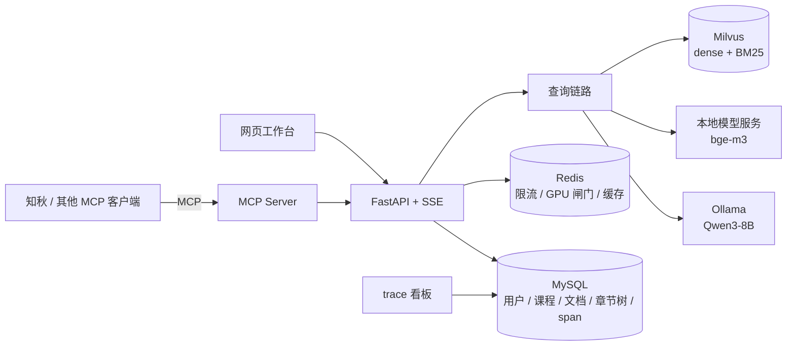

# 文渊（wenyuan）设计文档

> 一句话：一门课共用的学习资料 RAG 服务。老师上传的课程资料全班共享，学生的笔记只有自己能检索到；回答逐句标明出处，资料里没有就拒答；一台 GPU 服务器全班共用，学生通过网页工作台或自己的学习 Agent（经 MCP）使用。
> 结构：第 0 节是 v2 的方向和逐步的实验记录；第 1～10 节描述现在的系统；第 11 节是 v0.7（官方文档 + Stack Overflow）的实验，检索链路的结论仍然适用。
> 历史：2026-11-01 起是 v0.7（官方文档 + 私有笔记，`git tag v0.7.0`）；2026-11-02 深夜方向调整为课堂场景（第 0 节）；2026-11-07 第 1～10 节按 v2 重写，答案层评测见 0.14。

---

## 0. v2 方向：课堂学习资料库（2026-11-02）

> 本节是 v2 的方向和逐步的实验记录。第 1～10 节已按本节重写（2026-11-07），描述现在的系统。

### 0.1 为什么调整（复盘）

- **顺序错了**：一开始先挑了语料（官方文档）和评测集（Stack Overflow 题），再倒推产品是什么，结果做成了“另一个文档搜索”，正面撞上联网搜索。
- **定位和实际用法对不上**：部署定位写的是“小团队共享”，实际只在本机自用。Redis、MySQL、Milvus、Celery 都在为一个没有落地的场景服务，本机内存也撑不住：评测期间 Windows 虚拟内存多次耗尽，Docker 被系统杀掉。
- **重心放错**：真正不可替代的是私有资料，评测和优化却都集中在公共文档上（1184 题对 60 题）。
- **正确的顺序**：先定场景，再找能支撑场景的数据，最后按场景选技术栈。

### 0.2 场景

一门课共用的 RAG 服务：老师上传课程资料，作为全班共享的公共库；学生各自上传笔记，只有自己能检索到。问答同时检索两者并标明出处。系统部署在一台带 GPU 的服务器上，全班共用；学生通过网页工作台或自己的学习 Agent（如知秋，经 MCP）使用。

- **为什么不能只靠联网搜索**：课程讲义网上搜不到；答案要和老师讲的、考的保持一致。
- **为什么需要多用户、排队和缓存**：几十个学生共用一块 GPU，作业截止前集中提问；全班同一周学同一章，问题重复度高。

### 0.3 角色

| 角色 | 能做什么 |
| --- | --- |
| 老师 | 创建课程；上传、更新课程资料；给学生发邀请码；查看全班高频问题的汇总（只看汇总，不看个人笔记） |
| 学生 | 上传自己的笔记；提问；看课程目录和章节原文；看自己的 trace |
| 运维 | 部署；查看全站状态（GPU 排队、缓存、压测） |

### 0.4 演示数据与评测

- **课程资料**：哈佛 CS50x 2024，70 篇 Markdown，包括每周讲义、讲课转写、作业和练习，带原始链接和周次。来源是 Hugging Face 上的 `dev-jonathanb/cs50-educational-rag`，许可证 CC BY-NC-SA 4.0；只放在本地（`data/raw/cs50`），不进仓库。
- **学生笔记**：作者自己的算法笔记扮演学生 A；再用 DeepSeek 生成 2～3 位虚拟学生的笔记，用于隔离测试。
- **评测**：
  - **校准集**：CS50 数据集自带的 97 题。题目由模型生成，经人工打分（题目质量 4～5 分）；每题标注出处文件和原文片段，覆盖拼写错误、搜索式、语法不规范等提问风格。
  - **主评测集**：DeepSeek 按课程资料出题，分四类：单节事实、跨周综合、口语化或有错别字的提问、资料里没有的问题。出题模型和检索链路里的本地模型不同。
  - **私有笔记**：DeepSeek 按笔记出题（笔记作者同意为出题发送这批笔记），加上跨用户泄漏测试。
  - v0.7 的官方文档和 SO 题结果作为历史实验保留，不再是主线。

### 0.5 不做

公网上线、对接真实学校系统、PPT 和视频解析（PDF 放到第二阶段）、知识图谱。

### 0.6 怎么算做成了

- 课程资料检索：前 5 条结果里有能回答问题的，比例 ≥ 85%（独立裁判打分）。
- 私有笔记检索：前 5 条命中 ≥ 85%；跨用户泄漏为 0。
- 多人共用：模拟 20 名学生同时提问，0 超时、0 显存溢出。
- 服务器上一条命令部署；开发用的笔记本上有一个能跑得动的轻量模式。

现状见 1.4。

### 0.7 里程碑

| 里程碑 | 内容 |
| --- | --- |
| M1 | CS50 资料入库；课程和角色（老师 / 学生）；老师上传资料、邀请码 |
| M2 | 生成评测集；在新数据上验证 HyDE 和 LLM 重排，决定是否默认开启 |
| M3 | 老师端高频问题汇总；用新数据重做压测 |
| M4 | 文档、演示 |

进度见第 12 节。

### 0.8 待定：技术栈

这个场景确实需要多用户隔离、Redis 排队和缓存，所以现有架构基本保留（取消了改成 SQLite 单机版的计划）。后来定下的：Milvus 保留，原生 BM25 换成 jieba 分词后中文检索就能用，换更轻的方案收益不大；Celery 只用于大批量构建，课程资料和笔记上传时同步入库；笔记本内存不足靠启动前检查和评测的内存守卫缓解，正式部署用独立服务器（0.14、第 13 节）。

### 0.9 评测集与基线（2026-11-02）

**数据入库**：新集合 `chunks_v2`，BM25 改用 jieba 分词 + 去标点 + 英文转小写（原来的 `standard` 分词器把一整句中文当成一个词，中文笔记的 BM25 等于失效）。CS50 共 70 个文件、1435 个片段；学生 A（作者）的笔记共 124 篇、1153 个片段（只含作者自己写的笔记，不含第三方开源教程）。

**评测集**（都在 `data/eval/`，不进仓库）：

| 评测集 | 题数 | 出题方式 | 标准答案 |
| --- | --- | --- | --- |
| CS50 自带题 | 97 | 模型出题、人工打分 | 出处文件；其中 66 题另有原文片段 |
| 课程生成题 | 238 | DeepSeek 按课程段落出题：换说法 98、中文 80、跨周 60 | 出题所用的段落原文（跨周题两段） |
| 课程无答案题 | 40 | DeepSeek 按课程目录出题，中英各半 | 无，用于拒答测试 |
| 笔记题 | 160 | DeepSeek 按笔记出题：回忆 60、概念 60、混合 40（笔记 + 课程） | 段落原文；检索范围是“课程 + 自己的笔记” |

**证据级指标**：检索到的片段和标准答案的原文有足够重合（连续 5 个词，或 5 个汉字，重合比例 ≥ 0.5）才算命中，和切块方式无关。课程只有 70 个页面，页面级命中率都在 0.9 以上、分不出好坏，所以以证据级为主。

| 前 5 个片段里有证据（ev_hit@5） | 向量 | BM25 | 混合 |
| --- | --- | --- | --- |
| CS50 自带题（66 题有片段） | 0.894 | 0.909 | **0.939** |
| 课程生成题 | **0.794** | 0.567 | 0.748 |
| 　其中中文题 | | | 0.675 |
| 笔记题 | 0.775 | **0.869** | 0.844 |
| 　其中混合题（两段都在前 10 的比例） | | | 0.525 |

- **自带题太容易**：题目照着原文写，和原文用词重合度高，三种方式都在 0.9 左右，只能作参照。
- **没有一种检索方式到处最好**：课程题上向量最好、BM25 最差，因为换说法的题和中文题与英文原文几乎没有共同的词；笔记题上 BM25 最好，因为中文问中文笔记，jieba 分词后能直接对上。混合检索在两边都排第二。
- **最弱的是中文问英文课程（0.675）和需要两段证据的混合题（0.525）**。下一步的查询理解（把中文问题改写成英文检索词）、HyDE、LLM 重排都要在这几类题上验证。
- 目标：课程题和笔记题的证据级命中都 ≥ 85%（0.6 节）。

### 0.10 课程与角色（M1，2026-11-02）

- **数据**：`courses`（课程 id 同时就是它的资料在向量库里的 library）、`enrollments`（用户 × 课程 × 角色：teacher / student）、`invites`（邀请码，只存 SHA-256；默认可用 200 次、14 天过期）。任何人都可以开课并成为老师；学生凭邀请码加入。兑换时锁住邀请码那一行，两个人同时抢最后一次名额，只有一个能进；已经在课程里的人再用码，不消耗次数。
- **检索范围是上限，不是建议**：API 把调用者的课程列表传给查询链路，空列表就是“只有自己的笔记”，不再等于“全部公开资料”；查询理解和多跳检索里大模型选的库只能在这个列表里收窄，不能扩大。这两处在 v0.7 里都没问题（那时所有库都是公开的），改成课程后就成了越权的口子。
- **越权一律拒绝**：指定没加入的课程提问、看目录返回 403；拿别的课程的章节编号取原文返回 404，和不存在一样，不暴露它是否存在；学生调用老师的接口（上传资料、发邀请码）返回 403。
- **老师的资料**：`POST /v1/courses/{id}/materials` 上传 Markdown，走和笔记相同的入库流程，片段的上下文头用课程名；上传、删除后让这门课的问答缓存失效。CS50 的 70 个文件已经作为课程 `cs50` 的资料，老师是单独的 `cs50-teacher` 账号，作者自己的账号以学生身份加入。
- **验证**：浏览器里用两个测试账号走完“开课 → 生成邀请码 → 上传资料 → 学生凭码加入 → 提问”，答案引用的是这门课的资料；学生访问 CS50 的目录、指定 CS50 提问、上传资料、发邀请码都是 403，取 CS50 的章节是 404。

### 0.11 M2：查询理解、HyDE 与一个隐藏了很久的上下文截断（2026-11-03）

**结果**（证据级 ev_hit@5，混合检索为基线，* 为配对 bootstrap 显著）：

| | 课程题 | 中文 | 跨周 | 换说法 | 笔记题 | 自带题 |
| --- | --- | --- | --- | --- | --- | --- |
| 混合检索 | 0.748 | 0.675 | 0.917 | 0.704 | 0.844 | 0.939 |
| + 查询理解（向量用原问题） | **0.866*** | 0.825* | **0.983*** | **0.827*** | **0.875** | 0.939 |
| + 查询理解（向量用英文改写） | 0.790 | 0.800* | 0.867 | 0.735 | 0.825 | 0.909 |
| + 查询理解 + HyDE | 0.878* | **0.912*** | 0.933 | 0.816* | 0.819 | 0.864*（变差） |

- **查询理解**：课程题 +0.118，四类题全部显著；笔记题 +0.031（不显著）。向量一侧仍要用原问题，改写成英文反而变差，和 v0.7 的结论一致。线上链路本来就是这样，不用改。
- **HyDE**：只在“中文问英文课程”上有用，比只用查询理解再高 0.087（显著）；在笔记题上显著变差（−0.056），在自带题上也显著变差。原因是假想答案是英文：对英文课程是翻译加补术语，对中文笔记是噪声。下一步试“只在课程那一路加 HyDE”。
- **LLM 重排（第三阶段）作废**，原因有两个：
  1. **每个请求只有 4096 token**：`OLLAMA_CONTEXT_LENGTH=8192` 在这个 Ollama 版本里由并行槽位平分，并行 2 时每个请求 4096（日志 `limit=4098`、`n_seq_max = 2`）。重排 prompt 有 8000～10000 token，被截断 56 次，而且截掉的是开头，模型看不到问题和排在最前面的候选：41 道笔记题的标准答案原来排第 1，重排后恰好落到第 11 名，也就是模型挑出的 10 个之后。长度保护按“4 个字符一个 token”估算，中文笔记实际 1～1.5 个字符一个 token，所以超得更多。
  2. **按整页重排把证据挤出前 5**：课程的一页是一整讲的转写，重排后这一页的所有片段排在最前面。页面级命中几乎不变（0.962 → 0.933），证据级从 0.866 跌到 0.639。“按顶层章节”没起作用：CS50 每个文件只有一个一级标题，顶层章节就是整页。
- **影响不止重排**：回答阶段的 prompt 约 6000 token（这次实测 6382），并行 2 时同样会被截掉开头。也就是说，从 W3 把并行数从 4 改成 2 起（改之前每个请求只有 2048），线上回答和 v0.7 的答案层评测（E8）都是在截断状态下得到的，结论需要重测。
- **修复**：Ollama 并行数改为 1，GPU 闸门槽位同步改为 1，每个请求完整 8192；修复后同一类问答的回答 prompt 6382 token，截断 0 次。LLM 重排的长度保护改为按 token 计算，放不下就去掉末尾的候选；问题在 prompt 末尾再放一次；“按章节”改为按二级标题分组。
- **教训**：配置值不等于实际生效的值。上下文长度、并行数这类参数要从服务端日志确认，并在评测里加一项“有没有被截断”的检查。
- **这次实验也把内存撑爆了**（40 个候选 × 2 个并发，Windows 虚拟内存不足 3 次）。以后跑大模型实验：一次一个请求，候选数降到 20，内存超过约 85% 就暂停。

### 0.12 M2 收尾（2026-11-03）

- **只在课程那一路加 HyDE**：课程用“问题 + 英文假想答案”检索，笔记用原问题检索，再按 RRF 合并。笔记题 0.806，比只用查询理解（0.875）显著低，概念题跌得最多（−0.150）。原因是两路分开检索再合并时，课程那一路一定会分走一半的前排名额，哪怕问题只和笔记有关。只有需要课程资料的混合题略升（+0.050，不显著）。
- **修好的 LLM 重排仍是负收益**：按小节分组、20 个候选、一次一个请求，没有任何截断。课程题证据级 0.866 → 0.622（显著），前 10 也从 0.857 降到 0.660；页面级 0.962 → 0.929（不显著）。它选的页面基本是对的，但把整节片段排在前面，挤掉了真正的证据。v0.7 在 SO 题上的正结果（按页面计分，语料 4.6 万片段）不适用于这里。
- **结论**：线上保持“混合检索 + 查询理解”（课程题 0.866、笔记题 0.875、自带题 0.939）；HyDE、LLM 重排只作为评测里的可选项，默认关闭。离 85% 的目标，笔记题已达到，课程题还差中文题（0.825）这一块。
- **又一次把开发机卡死**：重排实验期间（09:13～09:23）Windows 记录了 6 次内存不足，每次占用最大的都是 Ollama 的 llama-server，约 13～15 GB。模型 37 层全在 GPU 上，但 Windows 把 GPU 分配也算进了系统提交内存；这台机器只有 14.8 GB 内存，加上 Docker 和桌面程序就开始频繁换页。第一版内存保护只看提交内存比例，整个过程都没到阈值，一次也没触发；真正耗尽的是物理内存。现在改成：可用物理内存低于 2 GB，或者提交内存超过 85%，都暂停。另外，从会话里启动的 Ollama 会随会话退出，评测进程却会残留，下次跑之前要先清理。

### 0.13 M3（一）：清理、门禁、启动脚本、引用、老师端汇总（2026-11-03，只写代码）

前一天的实验两次把开发机内存耗尽，最后一次在启动 Docker 时意外关机，所以这一轮只写代码、跑单元测试，不启动任何服务。

- **清理**（`python -m app.maintenance cleanup`）：默认只列出要删除的内容，加 `--yes` 才删除。范围是 `chunks_v2` 以外的 Milvus 集合（v0.7 的 18 个库、Qwen3 对比实验、章节摘要），不属于任何课程的公共文档，测试课程，以及测试账号和压测账号。笔记、课程资料和真实账号不动。
- **发版门禁换成 v2**：`eval/baselines.json` 为课程题、笔记题、自带题分别指定基线和指标（证据级 ev_*）；不指定基线时，按候选结果用的评测集和账号自动匹配；比较时跳过没有这项指标的题。用 M2 的重排结果试过，会被拦下（三项证据指标都显著变差）。
- **启动脚本**：启动 Docker 前检查可用内存是否有约 5 GB，启动模型服务前检查约 3 GB，不够就停下来提示（`-Force` 跳过）；`-Stop` 顺带结束残留的评测和入库进程；启动时发现残留进程会提醒。
- **引用直达原处**：章节表加了 `url` 列。CS50 入库时把每个小节标题上的链接存进来（879 个小节里有 809 个有链接：讲义是段落锚点，转写是视频时刻）。来源和引用优先用小节链接，并带上小节编号；工作台里，网页上有出处的直接跳转，笔记和老师上传的资料在页面里打开那一节的原文。已入库的 CS50 用 `python -m app.ingest.cs50 --links-only` 补链接，只需要 MySQL。
- **老师端高频问题**：学生每次在问答里提问，按“课程 × 问题”记一条（只存问题和时间，不存答案，老师自己的提问不记）。老师查看时，用 bge-m3 把最近 14 天的问题转成向量，与某一类中心的余弦相似度 ≥ 0.80 就归入这一类；只显示至少两位不同学生问过的类别，看不到是谁问的。记录失败不影响问答。0.80 这个阈值还没有标注数据验证。
- **还没在真实服务上验证**：以上都只有单元测试和静态页面检查。下次启动服务时要做：运行 `--links-only` 补链接；清理脚本先看列表、确认后再删；在浏览器里点一次引用、打开一次高频问题。

### 0.14 M3（二）：答案层评测、拒答测试和生成环节的缺陷（2026-11-06～07）

**设置**：从课程生成题里固定抽 100 道（中文 37、跨周 23、换说法 40）。本地 Qwen3-8B 回答并逐句校验，DeepSeek 当评委，只看课程的公开资料，不涉及笔记。评委给每个回答打正确性分（2 分为与参考答案一致），并对每一句判断“资料里有没有”。拒答测试用 40 道课程没讲的题（中英各半）和 40 道能答的题，只用本地模型。

**先补上的一处遗漏**：第一次运行 100 题里 94 题报错，因为真实库里还没有 0.13 节新加的 `sections.url` 列。迁移只在 API 或入库启动时执行，评测脚本不会触发。补跑迁移和 `--links-only` 后，809 个小节有了链接。

**四轮结果**：

| | 开始时 | 校验看全部来源 | 加：不跳过检索、回答改纯文本 | 加：拒答识别、格式修复 |
| --- | --- | --- | --- | --- |
| 完全正确（校验前 → 后） | 70.7% → 61.6% | 71% → 69% | 88% → 85% | 89% → **86%** |
| 　中文 / 跨周 / 换说法（校验后） | 69 / 48 / 63% | 81 / 52 / 68% | 92 / 74 / 85% | 97 / 65 / 88% |
| 课程没讲的题拒答 | 100% | — | 82.5% | **100%** |
| 能答的题被误拒 | 10% | — | 0% | **2.5%** |
| 带有害内容的回答（校验后） | | | | **4%** |

**发现与修复**：

1. **校验只看被引用的来源**：回答平均从 11.3 个来源里只引用 2.2 个，七成句子没有自己的 `[S#]`（模型习惯在段末标一次）。校验器只拿被引用的来源核对，把依据在别的来源里的句子判为无依据删掉，例如 `.tables`、`.schema` 这类正确的 SQLite 命令。在 41 个被删过句子的回答上对照：改成核对全部来源后，删掉的句子从 64 条降到 28 条，校验后的正确率从 61.6% 回到 70.7%；评委认为全部来源里都找不到的 16 条中，仍删掉 11 条。现在问的是“资料里有没有”，不再要求引用标号精确。
2. **分句**：英文句子以 `.` `!` `?` 结尾，但代码里的问号也会被当成句尾（Scratch 的 `if <touching (mouse pointer)?> then`），句首的列表编号“1.”也会单独成为一条“论断”，没有来源能支持。现在先把代码遮住再分句；只有后面跟着能开头的字符时才断句；列表编号不算句尾。
3. **检索命中却答不好**：同一批 100 题里，88 题的证据在前 5 个片段里，其中只有 60 题答对。逐题看剩下的 28 题，问题都在生成环节：9 题拒答、16 题部分正确、3 题答错。这时重排之类的检索优化帮不上忙。
4. **9 道拒答全是工程缺陷**：
   - 6 道是查询理解返回“不需要检索”：规则写的是只有打招呼才不检索，但 Qwen3 把“没学过编程会不会跟不上”“能不能和同学一起做作业”也判成了闲聊。现在只有很短的输入（不超过 10 个汉字，或不超过 30 个字符）才相信这个判断。
   - 3 道是 JSON 截断：回答要求输出 JSON，模型写 `` 时没转义双引号，受约束的 JSON 解码在这个引号处结束了字符串，后面的内容和引用都丢了，程序就判成拒答。现在回答改成纯文本，最后一行写 `SOURCES: S1, S3`；拒答时写 `NOT FOUND: <原因>`。
   
   同时，回答的提示词从 v0.7 的“技术文档”改为“课程资料和笔记”，并加了一条“问题有几问就答几问”，跨周题从 52% 升到 74%。
5. **拒答识别**：上面两处修好后，课程没讲的题拒答率掉到 82.5%，没拒的 7 题分两类：
   - 4 道是模型其实拒答了，但又列了来源，或者 `NOT FOUND` 不在第一行；
   - 3 道是模型硬答，校验删掉了 10/11、12/13、10/11 句，只剩碎片，而原来的规则要全部删光才算拒答。
   
   现在三种情况都算拒答：任何一行（代码块外）出现 `NOT FOUND`；每一句都在说“资料里没有”；校验删掉超过 60% 的句子。60% 是在 100 道能答的题上选的：没有一个完全正确的回答被删掉超过一半。拒答率回到 100%。
6. **“无依据”这个指标高估了问题**：回答变长以后（平均每题 3.5 句 → 5.8 句），评委判为“资料里找不到”的句子变多，带这种句子的回答一度占 26%。逐条读了 46 句，配上最相关的原文：约 13 句其实就在原文里（`return false` 阻止表单提交、session 用 `name` 作键），约 15 句是正确的常识（“Python 赋值不用声明类型”），4 句是分句和格式残留（一行 `SOURCES:` 混进了正文），真正答错的约 10 句，大部分已被校验删掉。评测现在会让评委把这些句子再分一次类：其实有依据 / 与资料矛盾 / 资料外但正确 / 资料外且错误。只有矛盾和错误两类计为“有害”。最终一轮评委的第一次判定里，有 44 句“找不到依据”，再看一遍：30 句有依据、10 句资料外但正确、3 句矛盾、1 句错误；校验后 100 个回答里有 4 个带有害的句子，占全部句子的 0.9%。

**没起作用的**：
- 提示词要求“只写资料里有的内容”，无依据句子的比例不降反升（20% → 25.5%，100 题上分不清是不是噪声）。
- 用 bge-m3 相似度或字面重合给每句打分，代替 Qwen3 校验器：两者都区分不开有依据和无依据的句子，AUC 分别是 0.61 和 0.52。
- Qwen3 校验器本身也不准：删掉的句子里只有 25% 是评委认为无依据的。它几乎从不给“部分有依据”（330 句里 4 次，评委给了 89 次），会把部分有依据的句子当成无依据删掉。这是剩下的误删的主要来源，留作下一个实验（开思考模式，或只删与资料矛盾的句子）。

**代价与局限**：
- 校验看全部来源后，prompt 更长，校验耗时中位数从约 0.9 秒升到约 2.2 秒。
- 跨周题仍是最弱的一类（65%），比上一轮的 74% 低，但 23 题上分不清是不是噪声。
- 只有一门课、100 道题，出题和评分用的都是 DeepSeek，可能偏向它自己的说法。
- 最后一轮跑到一半 DeepSeek 余额用完（402），每题单独记录报错，补跑时已评过的题走缓存。

**开发机上的运行经验**：
- Docker 的 WSL 虚拟机本身就占约 3.5 GB，容器合计不到 1 GB，所以给单个容器限内存没用。
- Qwen3 的 llama-server 在运行中越占越多：约 20 题后，物理内存从约 1 GB 涨到 3.5 GB，提交内存从 11.6 GB 涨到 15 GB。卸载模型就能全部收回。
- 页面文件设了最大值后，提交内存到顶时 Windows 会自动扩大页面文件，所以内存守卫按当前上限算的提交比例过于保守。现在两个阈值都能用环境变量调整：`EVAL_MIN_FREE_GB` 和 `EVAL_MAX_COMMIT`。这几轮用的是“空闲内存不低于 0.5 GB、不限制提交内存”。

### 0.15 M3（三）：在线验证和压测（2026-11-07）

- **清理脚本预览**（只列出，没有删除）：5 个旧的 Milvus 集合、18 个 v0.7 文档库（约 9900 个文档）、测试课程 `ui-demo`、25 个测试账号（`loadtest-*` 和几个 `ui-*`）。确认后由人执行 `--yes` 删除。
- **引用直达原处**：在工作台里用测试学生账号问 malloc 的问题，转写来源跳到讲课视频的具体时刻（`youtu.be/…?t=3892`），讲义来源带段落锚点（`notes/4/#copying`、`notes/5/#trees`，作业页的 `#hints`）；打开 CS50 页面核对过，锚点确实存在。
- **老师端高频问题**：两个测试学生各问一个相似的 malloc 问题，老师的面板里归为一类，显示“2 位学生 · 2 次”，不显示是谁问的。
- **压测脚本改为 v2**：v0.7 用 Stack Overflow 题和公共文档库提问；v2 的检索范围限定在调用者加入的课程里，没有课程的压测账号会被直接拒绝。现在改用课程生成题，压测账号先以学生身份加入题目所属的课程（账号名以 `loadtest-` 开头，清理脚本会连同选课和提问记录一起删除），结果文件只记状态和耗时。
- **1 个槽位的压测没跑完**：1 人连问 3 题全部成功，回答耗时 p50 6.6 秒、p95 10.9 秒，首个事件 p95 5.6 秒（这一轮包括 Qwen3 的加载）。5 人一轮跑到一半，空闲内存连续两次低于 0.4 GB（最低 0.2 GB，Windows 内存压缩涨到 2.8 GB），按安全线停止。
- **结论**：开发用的笔记本同时跑 Docker、bge-m3、Qwen3 和 API 已经接近上限，多人压测要在独立服务器上做。在那之前，对外只引用 v0.7（2 个槽位）的压测结果，并注明槽位数。

---

## 1. 背景与目标

### 1.1 为什么这样做

- **目标**：一个每个设计取舍都讲得清的 RAG 服务：效果用评测数据说话，后端组件只为真实需求服务。
- **场景先于技术**：v0.7 先挑了语料和评测集，做成了“另一个文档搜索”（复盘见 0.1）。v2 先定场景（一门课共用的学习资料库，见 0.2），再找支撑场景的数据（哈佛 CS50x），最后决定哪些组件留下。
- **不从零造轮子，也不 fork 整个仓库**：以 LightRAG（HKUDS/LightRAG，MIT，commit `aaebfe1`）为母本剪枝，只拷贝低耦合、读得懂的模块；本地 trace 和 MCP 复用自己的知秋项目。
- **和知秋联动**：知秋是学习助手 Agent（讲解 → 自测 → FSRS 复习 → 学习计划），通过 MCP 把文渊当作资料后端，检索范围是学生加入的课程加上他自己的笔记。
- **数据驱动迭代**：baseline → 逐题归因 → 针对性修改 → 用指标验证，同时说明延迟和成本代价。

### 1.2 为什么要 RAG，而不是联网搜索

- **课程资料搜不到**：讲义、作业说明、讲课转写是这门课自己的，答案要和老师讲的、考的保持一致，不能是网上的另一种说法。
- **学生的笔记更搜不到**：每个学生的笔记只有自己能检索到，而且只交给本地模型。
- **出处和拒答**：每句话标明出自哪一节，链接到讲义的段落锚点或视频的时刻；资料里没有就拒答，因为学习场景里学错比没学更糟。
- **可复现**：语料固定，评测才有意义，每个改动都能用同一批题对比。
- **章节结构**：知秋按课程目录排学习计划、按章节出题，这是搜索做不到的。

### 1.3 后端定位：不是高并发，是“单请求重”

- **本项目没有真正的高并发需求**，也不这么宣称。传统高并发（秒杀、IM）是请求又多又轻；LLM 应用是请求又少又重，每个请求要几秒、占 GPU，瓶颈在模型推理。
- 一个班几十人共用一台带显卡的机器，作业截止前集中提问，GPU 是最稀缺的资源。后端工程针对的是：**慢请求、稀缺资源、多用户、数据隔离**。
- 各组件的理由和现状：

| 组件 | 理由 | 依据 / 现状 |
| --- | --- | --- |
| 课程、角色、邀请码 | 一门课一个资料库；老师管资料，学生凭邀请码加入 | 没加入的课程一律 403，别的课程的章节 404（0.10） |
| 私有笔记隔离 | 学生的笔记只有自己能检索到 | 检索统一过滤；另一个用户问同样的问题，检索到的私有内容 0 条 |
| GPU 闸门 + 准入控制 | 一块 GPU 同时只能稳定生成 1 个回答，超出的请求要排队或快速失败 | v0.7 压测（2 槽）：20 人同时提问，不加闸门 78% 超时并 OOM，加闸门后 0 超时；1 槽的多人压测在开发笔记本上跑不完，待在独立服务器上重测（0.15） |
| 限流 | 防止一个人占满队列 | 按（用户, 接口）令牌桶 |
| 问答缓存（含防击穿） | 全班同一周学同一章，问题重复度高 | 同一课程共享缓存；有笔记的用户用自己的缓存键；资料更新时按课程失效 |
| SSE | 一次回答要几秒，要让学生看到进度 | 推送阶段事件（排队、理解、来源、答案） |
| 全链路 trace | 定位慢在哪、错在哪 | 每个学生只看得到自己的请求 |
| Celery 异步入库 | 大批量文档必须异步、可重试 | v0.7 构建 18 个文档库时使用；v2 的课程资料和笔记都很小，上传时同步入库（在线程池里执行）。老师一次上传几百页 PDF 时再走 Celery |

### 1.4 目标与现状

| 目标 | 标准 | 现状（2026-11-07） |
| --- | --- | --- |
| 课程资料检索 | 证据在前 5 个片段里 ≥ 85% | 0.866（课程生成题），中文题 0.825 |
| 笔记检索与隔离 | 证据在前 5 个片段里 ≥ 85%；跨用户泄漏 0 | 0.875；泄漏 0 |
| 答案 | 完全正确、少有害内容、该拒就拒 | 完全正确 86%；带有害内容的回答 4%；课程没讲的题全部拒答，能答的题误拒 2.5% |
| 多人共用 | 20 人同时提问 0 超时、0 显存溢出 | v0.7 在 2 槽时达到；1 槽在开发笔记本上只跑完 1 人一轮（p50 6.6 秒），多人压测要在独立服务器上做（0.15） |
| MCP 接入 | 知秋能用课程目录、片段、带引用的回答 | 7 个工具，经知秋的 MCP 客户端验证 |
| 可观测 | 每个请求的 span 树、各阶段耗时 | 工作台看板 |
| 部署 | 一条命令启动 | `scripts\wenyuan.cmd`；开发用笔记本内存紧张，见 0.14 |

### 1.5 本期不做

公网上线、对接真实学校系统、PPT 和视频解析（PDF 放到第二阶段）、知识图谱、模型训练和微调、复杂前端。

---

## 2. 使用场景

- **S1 开课**：老师开一门课，上传讲义、作业说明等 Markdown，生成邀请码发给学生（只显示一次，只存哈希）。学生在工作台输入邀请码加入。
- **S2 提问**：学生问“为什么 C 里没初始化的数组会打印出乱码？”，回答每句标明出处，点 `[S1]` 跳到讲义对应的段落，或讲课视频对应的时刻；课程没讲的（“怎么用 JWT 做登录”）明确拒答。
- **S3 用自己的笔记**：学生上传笔记，提问时同时检索课程资料和自己的笔记；只要用到了笔记，就只用本地模型回答，其他学生检索不到这些笔记。
- **S4 学习 Agent**：知秋经 MCP 调用 `outline` 按课程目录排学习计划，`search` 取原文讲解和出题，`ask` 回答提问。
- **S5 老师看高频问题**：全班最近 14 天问得多的问题，相似问题归为一类；至少两位学生问过才显示，看不到是谁问的。
- **S6 作业截止前**：几十人同时提问，GPU 闸门让请求排队；预计等不到的请求立刻得到 busy 和建议的重试时间，而不是 30 秒后超时。

---

## 3. 总体架构



### 3.1 技术栈

| 层 | 选型 | 理由 |
| --- | --- | --- |
| Web / API | FastAPI + SSE | 异步、流式推送阶段事件 |
| 向量与全文检索 | Milvus 2.6 | 原生 BM25 稀疏检索，一个组件做混合检索；BM25 用 jieba 分词，中文笔记和中文提问才能匹配上（0.9）；按课程和 owner 做标量过滤 |
| 业务库 | MySQL | 用户、课程、邀请码、文档、章节树、问题记录、trace span |
| 缓存 / 限流 / 闸门 | Redis | 一个组件承担三种角色，Lua 脚本保证原子性 |
| Embedding | bge-m3（本地 GPU） | 中英文都好；Qwen3-Embedding 在独立评测集上没有更好（11.4 的 E7） |
| LLM | 本地 Ollama + Qwen3-8B（4-bit），并行 1、8k 上下文 | 学生的笔记不出本机；并行 1 是因为 Ollama 把上下文平分给并行槽位（0.11） |
| 评测 | DeepSeek 出题和当评委 | 独立于被评的本地模型；只发送课程的公开资料，笔记只在作者同意时用于出题 |
| MCP | 官方 MCP Python SDK | 与知秋一致 |
| 部署 | Docker Compose（Milvus、MySQL、Redis） + 宿主机 GPU 模型服务 | 50 系显卡需要 CUDA 12.8+，模型服务放宿主机最稳 |

### 3.2 消息队列选型（为什么不用 Kafka / RocketMQ）

|  | Redis（Celery broker） | RabbitMQ | RocketMQ | Kafka |
| --- | --- | --- | --- | --- |
| 定位 | 轻量任务队列 | 通用业务消息 | 业务消息（事务、延迟、顺序） | 日志 / 事件流，高吞吐、可回放 |
| 本项目 | ✅ 已经要用 Redis，几乎零成本 | 任务丢失不可接受时升级 | Python 客户端弱，Celery 不支持 | 入库是独立任务，不是事件流；集群太重 |

### 3.3 模型分工

| 模型 | 作用 | 服务进程 |
| --- | --- | --- |
| bge-m3 | 文本转向量；老师端高频问题聚类 | `model_server`（sentence-transformers） |
| Qwen3-8B（4-bit） | 查询理解、多跳拆分、生成答案、逐句校验 | Ollama |
| bge-reranker-v2-m3 | 可选的交叉编码重排，默认关闭 | `model_server`（只在评测里按需加载） |
| DeepSeek | 评测出题、评委 | API，只在评测时调用 |

- **路由规则**：上下文里只要有私有笔记，就只用本地模型。
- **为什么 LLM 经过 Ollama，而不是像 bge 那样自己加载**：8B 模型 fp16 约 16GB，要 4-bit 量化；生成要逐 token 循环、管 KV 缓存和流式输出，这是推理引擎的工作；Ollama 是 OpenAI 兼容接口，和 DeepSeek 走同一个客户端；LLM 崩溃不影响 API 进程。生产环境的 Linux 多卡服务器一般换成 vLLM，接口相同。
- **重排和 HyDE 默认关闭**：在 v2 评测里都是负收益或只对一类题有用（0.11、0.12）。

---

## 4. 入库链路

1. **课程资料**：
   - **CS50**（`python -m app.ingest.cs50`）：70 个 Markdown 文件，读 front matter 里的标题、周次和原始链接；去掉标题上的链接、目录和时间戳；把每个小节标题上的链接（讲义的段落锚点、转写的视频时刻）存进章节表，879 个小节里有 809 个有链接。
   - **老师上传**（`POST /v1/courses/{id}/materials`）：Markdown，`course://<课程>/<文件>`，片段的上下文头用课程名；上传、删除后这门课的问答缓存失效。
2. **学生笔记**：工作台上传，或 `python -m app.ingest.private` 导入一个或多个文件夹（递归，只收 `.md`，子目录的文件按路径命名，可排除；导入前列出会被覆盖的笔记）。
3. **结构切块**：按标题层级切分，小节为子块、整节为父块；每个子块前加“课程 > 页 > 节”的上下文头；章节树写入 MySQL，供 `outline` 和章节原文使用。超长小节用固定长度切分兜底。
4. **写入 Milvus**：集合 `chunks_v2`，dense 向量（bge-m3）+ BM25 稀疏字段（jieba 分词、去标点、英文转小写）；每个片段带 `library`（课程 id 或 `private`）和 `owner_id`。
5. **同步还是异步**：课程资料和笔记都很小（CS50 全部 1435 个片段），上传时在线程池里同步入库，接口直接返回结果；v0.7 构建 18 个文档库（4.6 万片段）时用 Celery，CPU 和 GPU 任务分队列。
6. **幂等**：同一文件（同一 doc_id）重新上传时，Milvus 里的旧片段先删后写；MySQL 的章节树只在内容哈希变化时重写；被排除的旧文档会从库里删掉，不会继续被引用。

---

## 5. 查询链路

1. **查询理解**：一次结构化 LLM 调用，输出改写后的独立问题（消解“它”“那个”）、BM25 用的关键词和候选 API 名（“删光 Redis”→ `FLUSHALL`）、可能相关的课程、是否需要检索。改造自 LightRAG 的关键词抽取 prompt，并补上它缺的一点：LightRAG 检索阶段不看对话历史（`operate.py:4658`）。
   - 模型选的课程只能在调用者已加入的课程里收窄，不能扩大。
   - “不需要检索”只对很短的输入（打招呼、道谢）生效。Qwen3 曾把“没学过编程会不会跟不上”判成闲聊，直接拒答（0.14）。
2. **检索范围**：`library in [调用者的课程] or (library == "private" and owner_id == 调用者)`。课程列表为空时只检索自己的笔记。
3. **混合检索**：dense 用原问题（改写成英文反而变差，0.11），BM25 用关键词和候选 API 名，Milvus 内置 RRF 融合。多跳问题按需拆成最多 3 个子查询，拆出 2 个以上时按页面轮流交错合并（11.4 的 E9）。
4. **small-to-big**：子块回溯父块，单块超过 1500 token 就退到命中所在的小节，再不行就只用命中的片段；按 6000 token 的预算截断，通常给模型约 11 个来源。
5. **生成**：纯文本回答，每句后面标 `[S#]`，最后一行 `SOURCES: S1, S3`；资料里没有就写 `NOT FOUND: <原因>`。不用 JSON：模型写代码时不转义双引号，受约束的 JSON 解码会在引号处截断回答（0.14）。程序丢掉指向不存在来源的引用，一个有效引用都没有就拒答。
6. **逐句校验**：把回答拆成句子（代码和列表编号不拆），一次 LLM 调用逐句判断“资料里有没有”，看的是全部来源，不只是被引用的那几个。无依据的句子删掉，不改写（改写会产生新的、没有校验过的内容）。删掉超过 60% 的句子、任何一行写了 `NOT FOUND`、或者每一句都在说“资料里没有”，都算拒答。
7. **引用**：优先用小节链接，讲义跳到段落锚点，转写跳到视频时刻；笔记和老师上传的资料带章节编号，在工作台里打开那一节的原文。

### 5.1 记忆分层：文渊记资料，知秋记人

| 记忆 | 内容 | 放在哪 |
| --- | --- | --- |
| 课程知识 | 老师的资料怎么说 | 文渊 · 课程库 |
| 个人知识 | 学生自己的笔记 | 文渊 · 私有库（按用户过滤，只走本地模型） |
| 对话记忆（短期） | 最近几轮聊了什么 | 调用方传入；或文渊 Redis 中带 TTL 的 `conversation_id` |
| 学习者记忆 | 学过什么、掌握程度、何时复习 | 知秋 |
| 计算复用 | 同样的问题算过一次 | 文渊 · Redis 问答缓存（不算记忆，资料更新时失效） |

- **对话历史不在文渊长期保存**：会话本来就在 Agent 手里，存两份迟早会不一致；服务无状态才方便扩展。
- **不把生成的答案自动写回知识库**：生成内容可能有错，写回后会被当成资料检索出来，越用越不准。

---

## 6. MCP 工具

`wenyuan-mcp`（stdio）是 HTTP API 的薄代理，限流、GPU 闸门、缓存和课程权限对 MCP 调用同样生效。

| 工具 | 输入 | 输出 | 知秋用在哪 |
| --- | --- | --- | --- |
| `libraries` | — | 我加入的课程 | 选课 |
| `search` | question、libraries、history | 带出处的资料片段 | 讲课、出题 |
| `ask` | question、libraries、history | 简洁答案 + 引用（经过逐句校验） | 学习者提问 |
| `outline` | library、topic | 与主题相关的章节树 + section_id | 制定学习计划 |
| `get_section` | section_id | 整节原文 | 讲课时取完整章节 |
| `add_note` / `list_notes` | filename、content | 存入 / 列出私有笔记 | 把学习者自己的笔记交给文渊 |

输出是紧凑的中文纯文本，每段带出处链接，控制在 5500 字符以内；繁忙、限流、没找到都转成模型能看懂的提示，并附上建议的重试时间。

---

## 7. 后端工程

### 7.1 Redis（目标是保护稀缺资源，不是扛高并发，见 1.3）

顺序是限流 → 缓存 → GPU 闸门，细节和 v0.7 压测数据见 11.3：

- **限流**：按（用户, 接口）分别设令牌桶，Lua 原子执行，时间取 Redis 的 `TIME`；超限返回 429 和 `Retry-After`。
- **GPU 闸门**：公平排队的分布式信号量（Lua + ZSET），有每用户上限和租约；准入控制按“排队位置 × 平均占用时长 ÷ 槽位数”估算等待时间，等不到就立刻返回 busy。现在 1 个槽位，和 Ollama 的并行数一致。
- **问答缓存 + 防击穿**：键由规范化的问题、检索范围、对话历史和各库的版本号组成，资料更新时版本号加 1，旧条目自然失效；同一问题并发时只算一次。只做精确匹配，语义缓存要先用评测定阈值。

### 7.2 MySQL 表

| 表 | 内容 |
| --- | --- |
| `users` | 账号，只存 API key 的 SHA-256 |
| `documents` | 课程资料和笔记：`library`、`owner_id`、`url`、内容哈希 |
| `courses` | 课程；课程 id 同时是它的资料在 Milvus 里的 `library` |
| `enrollments` | 用户 × 课程 × 角色（teacher / student） |
| `invites` | 邀请码的 SHA-256、剩余次数、过期时间；兑换时锁行 |
| `sections` | 章节树，含小节链接 `url` |
| `questions` | 学生的提问（课程、问题、时间），供老师端高频问题使用，不存答案 |
| `spans` | trace |

### 7.3 API

- 问答：`POST /v1/ask`（SSE）、`POST /v1/search`
- 课程：`GET /v1/courses`（v0.7 的 `/v1/libraries` 保留给 MCP）、`POST /v1/courses`、`POST /v1/courses/join`、`POST /v1/courses/{id}/invites`、`GET|POST /v1/courses/{id}/materials`、`DELETE /v1/courses/{id}/materials/{doc_id}`、`GET /v1/courses/{id}/questions`（老师）
- 笔记：`POST|GET /v1/notes`、`DELETE /v1/notes/{doc_id}`
- 目录与原文：`GET /v1/outline`、`GET /v1/sections/{section_id}`
- 其他：`GET /v1/me`、`GET /v1/traces`、`GET /v1/traces/{id}`、`GET /healthz`、网页工作台 `GET /ui`

### 7.4 权限

- 指定没加入的课程提问、看目录返回 403；拿别的课程的章节编号取原文返回 404，和不存在一样；学生调用老师的接口返回 403。
- 每个学生只看得到自己的 trace；全站视图只允许本机访问。
- 老师端高频问题只显示至少两位不同学生问过的类别，不显示是谁问的；老师自己的提问不记录。

### 7.5 本地 trace 看板（仿照知秋）

一次请求是一棵 span 树（ContextVar 保存当前 span），存在 MySQL；写入尽力而为，失败不影响主流程；进程退出后遗留的 running span 标记为中断。看板展示各阶段耗时、排队时间、p50 / p95、缓存命中率和 span 瀑布图。

---

## 8. 代码复用

| 来源 | 内容 | 方式 |
| --- | --- | --- |
| LightRAG `lightrag/rerank.py` | rerank 调用、按 token 截断 | 拷贝后删到只剩本地模型 |
| LightRAG `lightrag/chunker/token_size.py`、`recursive_character.py` | 固定长度切块、超长小节兜底 | 拷贝，替换 `lightrag.utils` 依赖 |
| LightRAG `lightrag/prompt.py` | `keywords_extraction`、`rag_response` 等 | 拷贝后大改：合并多轮改写和路由 |
| LightRAG `operate.py` 的 `_apply_token_truncation`、`_build_context_str` | token 预算、上下文拼装 | 读懂后重写精简版 |
| 知秋 `tracing.py`、`traces.py`、`dashboard.py` | trace、看板 | 改造复用（SQLite 换成 MySQL） |
| 知秋 `mcp_server.py` | MCP Server 写法 | 参考 |

**协议**：拷入的 LightRAG 文件保留 MIT 声明（`third_party/LICENSES/LightRAG-MIT.txt`），文件头写明来源路径、commit 和修改说明。只拷读懂了的代码。

---

## 9. 评测

### 9.1 评测集（都在 `data/eval/`，不进仓库）

| 评测集 | 题数 | 出题方式 | 标准答案 |
| --- | --- | --- | --- |
| CS50 自带题 | 97 | 模型出题、人工打分 | 出处文件；66 题有原文片段 |
| 课程生成题 | 238 | DeepSeek 按课程段落出题：换说法 98、中文 80、跨周 60 | 出题所用的段落原文和参考答案 |
| 课程无答案题 | 40 | DeepSeek 按课程目录出题，中英各半 | 无，用于拒答测试 |
| 笔记题 | 160 | DeepSeek 按一位学生的笔记出题（作者同意）：回忆 60、概念 60、笔记 + 课程 40 | 段落原文 |

出题和评分用 DeepSeek，回答和校验用本地 Qwen3-8B，避免“自己出题自己答”。v0.7 的 Stack Overflow 题保留在 `eval/datasets/so_v1.jsonl`。

### 9.2 指标

| 层 | 指标 |
| --- | --- |
| 检索 | 证据级：前 5 / 前 10 个片段里有没有出题所用的原文（连续 5 个词或 5 个汉字，重合 ≥ 0.5），和切块方式无关；页面级只作参照 |
| 答案 | 完全正确（评委对照参考答案打 2 分）；逐句是否在资料里；无依据的句子再分为“其实有依据 / 与资料矛盾 / 资料外但正确 / 资料外且错误”，其中“与资料矛盾”和“资料外且错误”计为有害；是否引用到标准页面 |
| 拒答 | 课程没讲的题拒答率；能答的题误拒率；按中英文分开 |
| 隔离 | 另一个用户问同样的问题，检索到的私有内容条数 |
| 系统 | 各阶段耗时 p50 / p95；压测时的超时率、有效吞吐、显存溢出次数 |

### 9.3 做法

- **显著性**：同一批题逐题配对 bootstrap，95% 置信区间（`python -m eval.compare A.json B.json`）。
- **发版门禁**：`python -m eval.gate <新一轮>`，按评测集自动选基线，任何指标显著变差就失败。
- **按题记录错误**：一道题失败不会让整轮作废；模型调用全部缓存，补跑时只调用没完成的题。
- **按题型拆分报告**：中文、跨周、换说法分开看，平均数会掩盖最弱的一类。
- **内存守卫**：每题开始前检查空闲内存，不够就暂停（0.12、0.14）。
- **不进仓库的内容**：课程原文、评测题和回答原文只在本地（`data/`、`.cache/`），`experiments/` 里只有题号、得分和汇总。

### 9.4 当前结果

| | 结果 |
| --- | --- |
| 课程生成题：证据在前 5 | 0.866（混合检索 0.748 → 加查询理解） |
| 笔记题：证据在前 5 | 0.875 |
| 答案完全正确（100 道课程题，校验后） | 86%（中文 97%、跨周 65%、换说法 88%） |
| 带有害内容的回答 | 4%（有害句子占全部句子 0.9%） |
| 课程没讲的题拒答 / 能答的题误拒 | 100% / 2.5% |
| 跨用户泄漏 | 0 条 |

过程见 0.9～0.14；v0.7 的实验见第 11 节。

---

## 10. 目录结构

```text
RAG项目/
├── app/
│   ├── api/          # FastAPI 路由、SSE、认证、网页工作台、看板
│   ├── cache/        # 问答缓存、限流、GPU 闸门
│   ├── db/           # MySQL 模型与迁移
│   ├── generation/   # 生成答案、逐句校验
│   ├── ingest/       # CS50 与课程资料、笔记导入、切块、v0.7 的抓取和文档库构建
│   ├── models/       # LLM 客户端（含缓存）、本地模型服务客户端
│   ├── query/        # 查询链路、查询理解、多跳、目录、HyDE
│   ├── retrieval/    # Milvus 检索、RRF、上下文组装、重排
│   ├── tracing/      # span
│   ├── workers/      # Celery 任务（v0.7 文档库构建）
│   ├── courses.py    # 课程、角色、邀请码
│   ├── insights.py   # 老师端高频问题
│   ├── maintenance.py
│   └── mcp_server.py
├── model_server/     # 宿主机 GPU 模型服务（bge-m3）
├── eval/             # 出题、检索 / 答案 / 拒答评测、比较、门禁、压测
├── experiments/      # 每轮评测的题号、得分和汇总
├── scripts/          # Windows 一键启动 / 停止
├── tests/
└── docker-compose.yml
```

---

## 11. 实验记录（v0.7：官方文档 + Stack Overflow）

> v0.7 的语料是 18 套官方文档（约 4.6 万个片段），评测是 1184 道 Stack Overflow 真实问题。检索链路的结论（查询理解、BM25 用候选 API 名、有了查询理解后 rerank 变成负收益、多跳的合并方式、评测集被训练数据污染）在 v2 里仍然成立或已重新验证。
### 11.1 W1（2026-11-01）
- **链路**：抓取 → 正文提取 → 分节 → 切块 → bge-m3 → Milvus → 评测，已跑通；trace 写入 MySQL。
- **语料**：FastAPI + Redis 清洗后共 920 页，只有约 5000～5800 个 chunk，撑不起专用向量库，因此改用 DevDocs 扩充。
- **噪声**：Redis 约一半抓取页是噪声（企业版、发布说明、9 种语言重复的用例和客户端文档），已排除 449 页、去重 3 页。
- **实验**（纯向量，217 题，排除不适用）：

| 方案 | 整体 Recall@5 | FastAPI | Redis |
|---|---|---|---|
| E0 固定 512 token | 0.352 | 0.366 | 0.316 |
| E1b 按小节 + 合并短小节 | **0.383** | **0.391** | **0.363** |

  清洗之前，按小节切块在 Redis 上更差；清洗并排除坏标注之后，两个库都领先。之前的结论是噪声造成的假象。
- **主要失败类型**：用意图找命令（“删除所有数据”→ FLUSHALL），问题里没有命令名。对症的是查询理解（E6）和 BM25（E2）。

### 11.2 W2（2026-11-01）
- **语料**：18 个库、9943 页、46,443 个 chunk（DevDocs 16 套 + FastAPI、Redis 官网）。
- **评测**：1184 道 SO 题（排除人工标为“不适用”的题）。页面级指标，显著性用配对 bootstrap 95% 置信区间（`python -m eval.compare A.json B.json`）。

| 方案 | Recall@5 | Recall@10 | MRR | 检索延迟 p50 |
|---|---|---|---|---|
| E1 纯向量（按小节 + 合并短小节） | 0.483 | 0.587 | 0.391 | 5 ms |
| E2 + BM25（RRF） | 0.467 | 0.584 | 0.375 | 5 ms |
| E3 E2 + rerank 前 50 | 0.490 | 0.617 | 0.390 | 437 ms |
| E6 纯向量 + 查询理解 | 0.475 | 0.574 | 0.393 | 5 ms |
| E6 混合 + 查询理解 | 0.527 | 0.649 | 0.442 | 5 ms |
| **E6 混合 + 查询理解，dense 用原问题** | **0.531** | **0.660** | **0.444** | 4 ms |
| E6 上一行 + rerank 前 50 | 0.507 | 0.643 | 0.407 | 438 ms |

查询理解另需一次 LLM 调用：本地 Qwen3-8B 约 0.8s。

- **查询理解是最大的单项提升**：混合 + 查询理解相对 E3，四个指标都显著提升（Recall@5 +3.7，MRR +5.2），而且不需要 rerank 的 430ms。机制正是 W1 的失败分析：问题里很少出现 API 名，原始 BM25 抓不到关键词（E2 甚至显著变差）；LLM 补出 `FLUSHALL`、`dropna`、`EXPLAIN` 之后，BM25 才起作用。
- **改写对 dense 没帮助**：纯向量 + 查询理解与 E1 没有显著差异。短英文改写丢掉了原问题正文里的报错和代码；dense 用原问题、BM25 用 LLM 关键词，两边各取所长。
- **有了查询理解之后，rerank 变成负收益**：Recall@5 −2.4、MRR −3.7（显著），FastAPI 从 0.40 降到 0.30。和 E3 中观察到的"reranker 偏爱 API 参考页"一致。默认关闭 rerank。
- **端到端 `ask`**：抽查中英文题目，修了两个让正确答案变成拒答的问题：①巨型父块独占上下文预算（改成父块逐级回退，见第 5 节第 4 步）；②Qwen3-8B 用中文回答时，常常只在 `citations` 字段里给来源、正文不写 [S#]，引用校验只认行内标记（改成两处合并校验，不存在的编号仍然丢弃）。
- **E5 章节摘要：负结果，默认关闭**。对 3076 个教程页父块生成摘要和 3～5 个"学习者会怎么问"（本地 Qwen3-8B，约 40 分钟，0 失败），共 18,397 行，存入单独的 collection，与 chunk 结果做 RRF。

  | 在"混合 + 查询理解"上 | Recall@5 | MRR |
  |---|---|---|
  | 不加摘要 | 0.531 | 0.444 |
  | + 摘要，RRF 权重 1.0 | 0.474 | 0.419 |
  | + 摘要，RRF 权重 0.6 | 0.531 | 0.444 |

  - **挤占效应**：摘要只覆盖教程页。融合后前 5 名里教程页的占比从 62% 升到 80%，标准答案是 API 参考页的 435 道题，Recall@5 从 0.546 跌到 0.433。
  - **该受益的地方也没受益**：标准答案是教程页的 663 道题，0.527 → 0.513。降权最多做到"无害"：权重 0.6 时摘要只能排到第 40 名以后，结果与不加相同。权重 0.3 时则一条都进不了前 50（chunk 列表第 50 名的 RRF 分数是 1/110，摘要第 1 名乘以 0.3 后只有 0.3/61）。调权重之前要先算清 RRF 的分数范围。
  - **适用边界**：SO 题是带正文、代码、报错的长问题，dense 已经能利用这些信息。"学习者会怎么问"索引更可能帮到短的口语化问题（知秋的典型输入），现有评测集测不到，等多轮 / 口语子集建好后再测。
  - 摘要不浪费：`outline` 工具把它挂在章节树上，供知秋制定学习计划。

### 11.3 W3（2026-11-02）：服务化与共享部署
- **HTTP API**：`POST /v1/search`（只返回带出处的片段）、`POST /v1/ask`（默认 SSE）、`/v1/notes`（私有笔记的增、查、删）、`/v1/libraries`；API key 认证，数据库只存 key 的 SHA-256。
  - **SSE 推送的是阶段事件，不是逐字 token**：`queued`（排队位置）→ `understanding` → `sources` → `done`。答案要先经过引用校验（假引用删掉，没有有效引用就拒答），逐字推送会让学习者先看到之后又被撤回的句子。热启动时约 1 s 出现来源，3～4 s 出现答案。
  - 查询链路是同步代码（httpx、pymilvus、SQLAlchemy），每个请求在线程里执行，通过队列把事件交回事件循环；线程复制请求的 context，所以 span 都挂在同一个 trace 下。
- **Redis 守卫**（顺序：限流 → 缓存 → GPU 闸门）：
  - **限流**：按（用户, 接口）分别设令牌桶，Lua 脚本原子执行，时间取 Redis 的 `TIME`，避免多个 API 实例时钟不一致；超限返回 429 和 `Retry-After`。
  - **GPU 闸门**：分布式公平信号量，用 Lua 加 ZSET 实现。同时运行的请求数不超过 `slots`，每个用户最多占 `per_user` 个；其余请求按到达顺序排队，已达上限的用户会被跳过，不挡后面的人。槽位是租约，进程崩溃后会过期；放弃排队的请求会被清出队列。
  - **准入控制**：记录"占用一个槽位的平均时长"（EWMA）。排在第 k 位的请求预计要等 k × 平均时长 ÷ slots；如果已经超过等待上限，立刻返回 busy，并把预计等待时间放进 `Retry-After`。
  - **问答缓存 + 防击穿**：键由规范化的问题、文档库、对话历史和各库的版本号组成；重新入库时版本号加 1，旧条目自然失效，不用逐条删除。同一个问题并发到达时，只有第一个请求去计算，其余请求等它的结果，不占 GPU；第一个请求失败时，等待者自己接手。只做精确匹配：语义缓存需要用评测确定阈值，否则会误命中。
- **私有库**：笔记写在同一个 collection 里，`library = "private"`，带 `owner_id`。Milvus 的 `add_collection_field` 可以原地加字段，4.6 万个已有 chunk 不用重建索引。
  - **所有检索都经过 `scope_filter`**：`library in [公共库] or (library == "private" and owner_id == 当前用户)`。客户端传来的公共库列表里如果有 `"private"`，会被剔除，所以别人的笔记只能通过 owner 条件匹配。在真实 Milvus 上测过 dense、BM25、hybrid 三种检索和五种参数组合，都看不到他人的笔记。
  - **缓存隔离（修复了一个隐私漏洞）**：原来的缓存键不区分用户，A 基于自己笔记得到的答案，B 问同一个问题时可能直接命中。现在上传过笔记的用户，缓存键里会带上他自己的私有库版本号；没有笔记的用户仍然共享公共缓存。
  - **路由**：上下文里只要出现私有来源，就用 `local_llm` 生成答案；trace 里记录 `private_context` 和 `answer_model`。
- **看板**（工作台的「看板」标签，`/v1/traces`）：**每个用户只看得到自己的请求**。trace 里有提问内容和模型对它的理解，多用户共享时不能互相可见：按根 span 上的 `user_id` 筛选，别人的 trace 编号返回 404（和不存在一样，不暴露它是否存在）。GPU 闸门只显示占用了几个槽位，不显示是谁。全站视图 `/dashboard/api` 只留给运维（压测脚本用），只允许本机访问，页面上不再链接。只读，展示最近的请求、各阶段耗时、排队时间、p50/p95、缓存命中率和闸门占用，点开某个请求可以看 span 瀑布图。
- **网页工作台**（`/ui`）：给不想用命令行的学习者，和其他客户端一样只调 `/v1` 接口（问答走 SSE，阶段实时显示；笔记上传、删除；按主题看章节树、点开全文），trace 看板也合并进来作为一个标签，只显示自己的请求。浏览器可以记住多个账号并在右上角切换（`GET /v1/me` 取账号名）。第一次打开时可以起名建号，但这个接口和看板一样只允许本机访问，共享部署时仍由管理员发 key。`scripts/wenyuan.ps1` 按依赖顺序拉起 Docker、模型服务、专用 Ollama 和 API，已在运行的部分跳过。

**压测**（`python -m eval.loadtest`）：N 个独立用户，每人连续问 3 个不同的真实 SO 问题；客户端 30 s 超时；每轮开始前让缓存失效。Ollama 并行数 2，一块 RTX 5070 Ti 16GB，同时运行 bge-m3 模型服务。

| 20 人同时提问（60 个请求） | 不加闸门 | 闸门 2 槽 + 准入控制 |
|---|---|---|
| 成功 | 13 | **19** |
| 超时 | **47（78%）** | **0** |
| 快速拒绝（busy） | 0 | 41，中位数 0.11 s 返回 |
| 有效吞吐（在超时内完成的答案） | 8.7 个/分钟 | **21.9 个/分钟** |
| 首个事件 p95 | 27.9 s | **0.21 s** |
| GPU OOM | 2 次（Ollama 崩溃、重新加载） | **0** |
| 压测结束时仍在运行的请求 | 14 个（客户端早已放弃） | 0 |

- **不加闸门时，过载会导致拥塞崩溃**：客户端已经放弃的请求仍在占用 GPU，后面的请求也跟着超时，有效吞吐从 10 人时的 26 个/分钟跌到 8.7 个/分钟。闸门把超出能力的请求挡在 GPU 之外，而且立刻告诉客户端。
- **取舍**：10 人时，不加闸门的一组 30 个请求全部完成（p95 25 s，已接近 30 s 的超时线）；加闸门的一组拒绝了 9 个。20 s 的等待上限偏保守，这是"快速失败"和"尽量服务"之间的一个可调参数。
- **槽位数要按实测设置，不能照抄推理服务的配置**：Ollama 设 4 个并行槽位时，4 路并发生成会让 16GB 显卡 OOM，Ollama 崩溃，正在处理的请求全部失败。改为闸门 2 槽、Ollama 并行数 2 后，压测期间 0 次 OOM。不加闸门时，即使 Ollama 并行数是 2 也会 OOM：大量请求堆在 Ollama 内部队列里，llama-server 频繁切换各请求的 prompt 状态，临时显存分配失败。
- **压测找到的 4 个 bug**（单用户测试都发现不了）：
  1. 每个请求新建一个 MilvusClient（一条新的 gRPC 连接），并发时被 Docker 端口转发拒绝 → 每个进程共用一个客户端。
  2. Redis 连接在突发请求下一次开出太多，`localhost` 还会先试 IPv6 → 改用有上限的阻塞连接池，地址改为 `127.0.0.1`。
  3. 客户端断开时，Starlette 会取消流式响应，`finally` 里的 `await ticket.release()` 也被取消，槽位一直泄漏到租约过期（两个超时请求让整个闸门被占了好几分钟）→ 释放操作放进 `anyio.CancelScope(shield=True)`，并用"模拟真实网络让出事件循环"的测试复现。
  4. API 每个请求都新建 LLM 客户端，并且读取评测用的磁盘缓存 → 进程内共享客户端；线上服务不使用评测缓存。

### 11.4 W4（2026-11-02）：MCP、论断级校验、多轮评测
- **MCP 服务**（`wenyuan-mcp`，stdio）：作为 HTTP API 的薄代理。限流、GPU 闸门、缓存和私有库隔离对 MCP 调用同样生效，MCP 不会成为绕过保护的后门。
  - **7 个工具**：`libraries`、`search`、`ask`、`outline`、`get_section`、`add_note`、`list_notes`。
  - **输出**：紧凑的中文纯文本，每段都带出处链接，控制在 5500 字符以内。知秋会把工具输出当作一份资料，默认上限是 6000 字符。
  - **错误**：繁忙、限流、没找到都转成模型能看懂的提示，并附上建议的重试时间。
  - **验证方式**：用知秋自己的 `McpClientPool` 以 stdio 子进程方式连接（没有改知秋的代码），7 个工具全部可调用。配置示例见 `examples/koyo-mcp.json`，只读工具在知秋里设为 `network` 权限：知秋准备资料时只会从 `network` / `external_mcp` 类工具获取外部资料，这类调用还会经过它的隐私泄漏检查；写操作 `add_note` 设为 `external_mcp`，每次需用户批准。最初设成 `read`，结果准备资料时不会用到文渊。配置文件要放在知秋能读到的普通目录（如 D 盘项目下被 gitignore 的 `.cache/koyo/`）：最初放在一个由开发沙箱创建的 `%APPDATA%\zhiqiu` 目录里，沙箱内外的读取测试都通过，但从桌面快捷方式启动的知秋就是读不到，挪到 D 盘后正常。
- **`outline` 的主题定位**：最初只用 dense 检索，"持久化"排第一的是 `PERSIST` 命令页，持久化指南连前 14 名都没进。改为和 `ask` 一样先做查询理解再做混合检索，并把主题包装成学习目标（"我想系统学习 Redis 的「持久化」"），教程页排在参考页前面。改完后排第一的是 Redis persistence 指南，顶层章节挂上了 E5 生成的摘要。
- **E8 论断级引用校验**：把答案拆成句子，每句带上它引用的来源；一次 LLM 调用逐句判断"引用的原文是否支持这句话"，删掉不支持的句子，全部删光就拒答。拆句时，代码里的点号（如 `df.dropna()`）不算句号。

  | 100 道 SO 题，裁判 DeepSeek（独立于被评的 Qwen3-8B） | 校验前 | 校验后 |
  |---|---|---|
  | 不受原文支持的论断占比 | 23.4% | **10.3%** |
  | 含不受支持论断的答案占比 | 47.8% | **23.0%**（−26 个百分点，CI [−36, −17]） |
  | 完全正确（对照 SO 采纳答案，2 分） | 44% | 44%（差值 0，CI [−5, +6]） |
  | 给出答案的题数 | 92 | 87 |

  - 删除的精确率 64%，召回率 67%：删掉的句子里约 2/3 确实不受支持，不受支持的句子里约 2/3 被删掉了。
  - 新增的 5 个拒答，在校验前没有一个是完全正确的（评分 1、1、0、1、0）。
  - 校验器未命中缓存时的耗时 p50 为 846 ms，最长 2.2 s。
  - **结论**：默认开启。学习场景里学错比没学更糟，用不到 1 秒的代价换来"含错答案减半"，而且正确率没有损失。
  - **裁判**：先试过本地 Qwen3 开启思考模式当裁判，但它和被评的是同一个模型，而且每题要 30 秒以上；最终改用 DeepSeek，通过 `JUDGE_*` 配置。
- **E6 多轮子集**：把 199 道 SO 题改写成两轮对话。第一轮引入话题，第二轮的追问把**最具体的技术对象**换成"它 / 那个"。改写由 DeepSeek 完成，和负责消解指代的本地模型不同。第一版 prompt 生成的题里，71/200 只隐藏了库名，可评测时本来就会告诉检索器是哪个库，这些题测不出任何东西；改 prompt 并加了过滤之后才有效。

  | 199 道两轮对话 | Recall@5 | MRR |
  |---|---|---|
  | 原问题（上限） | 0.543 | 0.446 |
  | 只有追问，不给历史 | 0.215 | 0.182 |
  | 追问 + 历史（文渊的做法） | **0.488** | **0.395** |

  - 没有历史时召回率不到一半；带上历史后显著回升（Recall@5 +27.3，CI [+21.3, +33.5]），收回了 83% 的损失。
  - 离上限还差 5.5 个点（Recall@5 的差距不显著，MRR 的差距显著）。剩下的失败题大多是对话本身就有歧义，例如第一轮问"什么是 tensor"，追问"how do I get it"。
- **健壮性**（评测中发现）：
  - Ollama 偶尔返回 500：LLM 客户端对 5xx 和网络错误重试一次。
  - 模型在 JSON 模式下陷入重复循环（`token repeat limit reached`）：温度为 0 时每次都会重现，所以改用采样加频率惩罚重试两次，仍然失败就抛出明确的 `LLMError`。
  - 评测按题记录错误，不会因为一道题失败而整轮作废。
- **CI 与评测门禁**：GitHub Actions 每次 push 跑单元测试。完整评测需要 GPU、语料和本地模型，托管 CI 跑不了，所以另做了发版前的回归门禁 `python -m eval.gate <新一轮评测>`：和 `eval/baselines.json` 里的基线逐题做配对 bootstrap，任何指标的 95% 置信区间整体落在 0 以下就失败，退出码为 1。门禁拦下过一次真实的回归，见下面 E9。
- **E9 多跳检索（跨库问题）**：评测集由 DeepSeek 生成。从 12 组常一起用的库（FastAPI+Redis、Django+PostgreSQL、Celery+RabbitMQ 等）里，取 A 库一个教程章节和 B 库中与它最相关的章节，让 DeepSeek 写一个必须同时用到两段才能回答的问题；组合不自然的就跳过。120 次尝试得到 66 题，标准答案是两个页面。

  | 66 道跨库题 | 两页都在前 5 | 两页都在前 10 | 多出的 LLM 调用 |
  |---|---|---|---|
  | 单次检索 | 0.182 | 0.303 | 0 |
  | **拆分（decompose）** | **0.303** | **0.455**（+15.2，CI [+3.0, +27.3]） | 1 |
  | 迭代（检索 → 判断缺什么 → 补查，最多 3 轮） | 0.288 | 0.409 | 约 2 |

  - **合并方式比策略本身更关键**：最初用 chunk 级 RRF 合并各子查询的结果，拆分和迭代**都比单次检索差**（两页都在前 10 的比例：0.29 和 0.17）。原因是章节多的页面在每个列表里都有命中，累计得分最高，把"某个子查询排第一、但只出现在一个列表里"的页面压了下去。各子查询前 5 名的并集里，两页都在的比例有 0.49，说明子查询本身找到了。改为**按页面轮流交错**（每个子查询依次贡献一个页面）后，拆分从 0.29 升到 0.45。
  - **门禁拦下的回归**：如果每个问题都拆，1184 道单跳 SO 题的 Recall@5 会显著下降 2.0 个点（CI [−3.9, −0.1]），门禁不通过。原因是单跳问题往往只拆出 1 个子查询，它和第一轮结果交错，反而打乱了原有排序。改为**按需拆分**：拆出的子查询少于 2 个时保留第一轮结果。改完后单跳 Recall@5 为 0.534 对 0.532，门禁通过；跨库题仍是 0.455。
  - **结论**：`ask` 默认开启按需拆分（`AskConfig.multihop = "decompose"`），每个问题多 1 次 LLM 调用。迭代模式效果不如拆分，成本却是拆分的两倍，保留为可选项。迭代模式还修了一个问题：模型会重复生成已经查过的查询，现在遇到重复就停止。

- **E7 BGE-m3 对比 Qwen3-Embedding-0.6B（只换向量模型）**：用 Qwen3 重新计算 46,443 个 chunk 的向量（`python -m app.ingest.reembed`，10.6 分钟），写入新 collection。文本、切块、BM25 字段全部相同。查询使用 Qwen3 自带的 query 指令前缀，文档不加前缀。两个模型参数量相当（0.6B 对 568M）。

  | 评测集 | 设置 | BGE-m3 | Qwen3 | 差值 |
  |---|---|---|---|---|
  | SO 真实问题（1184） | 纯向量 Recall@5 | 0.483 | **0.601** | **+11.8**（CI [+9.5, +14.1]） |
  | SO 真实问题 | 最佳配置 Recall@5 | 0.531 | 0.603 | +7.2（显著） |
  | DeepSeek 写的多轮题（199） | 追问 + 历史 Recall@5 | 0.488 | 0.513 | +2.5（不显著） |
  | DeepSeek 写的跨库题（66） | 单次检索 Recall@10 | 0.652 | 0.583 | **−6.8**（CI [−12.1, −1.5]） |
  | DeepSeek 写的跨库题 | 拆分 Recall@10 | 0.689 | 0.720 | +3.0（不显著） |

  - **结论：默认仍用 BGE-m3**。Qwen3 在 SO 上大幅领先，但在两个**独立生成**的评测集上，一个没有显著差异，一个显著更差。最可能的原因是**评测集污染**：Qwen3-Embedding 的训练数据很可能包含 Stack Overflow 问答，相当于"见过考题"。另一个可能的因素是 SO 题偏长、夹杂代码和报错，这类文本正好是 Qwen3 的强项。两种解释都意味着 SO 上的提升不能直接当作真实收益。
  - **教训**：只看一个评测集，会得出"换模型涨 12 个点"的错误结论。凡是用公开数据构建的评测集，都要用训练数据里不可能出现的题目交叉验证。
  - 换上 Qwen3 后，查询理解 + BM25 在 SO 上几乎不再有增益（0.601 → 0.603，不显著）。在 BGE 上它带来 +4.8，说明这一步补的正是 BGE 不擅长匹配的 API 名。
  - Qwen3 可以通过配置使用（`reembed` 加评测的 `--embed-model` / `--query-prompt`），模型服务支持按请求指定 `prompt_name`。

- **私有库评测**（`python -m eval.private_eval`）：用作者自己的 6 篇学习笔记（Notion 导出：RAG 费曼复盘、HTTP / FastAPI、数据库、Redis、SSE、消息队列）建私有库，由**本地 Qwen3** 按小节出题，共 60 题。笔记内容遵守路由规则，不发给外部 API；代价是出题和答题的是同一个模型，结果可能偏乐观。笔记、题目和逐题结果只存在 gitignore 排除的 `.cache/private_eval/`，仓库里只有汇总分数。

  | 60 题 | 结果 |
  |---|---|
  | 笔记主人：自己的笔记在前 5 名 | 86.7%（MRR 0.737） |
  | 笔记主人：私有内容进入回答上下文（因而走本地模型） | 93.3% |
  | **另一个用户问同样的问题：检索到的私有内容** | **0 条** |

  - 没命中的 8 题，问的都是公共文档里也有的知识（例如"FastAPI 参数校验失败返回什么状态码"），官方文档排在笔记前面是合理的。记录个人理解和错题为主的两篇笔记（数据库、RAG 费曼复盘）全部命中。

## 12. 里程碑

| 阶段 | 内容 | 状态 |
| --- | --- | --- |
| v0.7（W1～W4） | 官方文档 + SO 评测；服务化、共享部署、MCP、逐句校验、多轮、多跳 | ✅ `git tag v0.7.0`，见第 11 节 |
| M1 | CS50 入库；课程和角色；老师上传资料、邀请码 | ✅ 0.10 |
| M2 | 生成评测集；在新数据上验证查询理解、HyDE、LLM 重排 | ✅ 0.11、0.12 |
| M3 | 清理脚本、v2 门禁、启动脚本、引用直达、老师端高频问题；答案层评测和拒答测试 | ✅ 代码与评测（0.13、0.14）；引用和高频问题已在真实服务上验证（0.15）。待做：清理脚本确认删除；在独立服务器上按 1 个槽位重做压测 |
| M4 | 文档、演示 | 进行中 |

## 13. 风险与应对

| 风险 | 应对 |
| --- | --- |
| 开发用笔记本（14.8 GB 内存）同时跑 Docker、bge-m3、Qwen3 和桌面程序会卡死 | 启动前检查可用内存；评测一次一个请求，每题前检查空闲内存；用完卸载模型；正式部署用独立服务器 |
| 评测偏差：出题和评分都是 DeepSeek，只有一门课 | 回答模型和评委分开；结论都带样本量和配对置信区间；逐条人工抽查（0.14 读了 46 句评委判为无依据的句子）；以后加第二门课 |
| 课程资料的许可证（CC BY-NC-SA 4.0） | 课程原文、评测题和回答原文都不进仓库，使用者运行命令自己下载 |
| 小模型能力不够 | 先查工程原因：0.14 里 9 道“有证据却拒答”全是工程缺陷；需要时再把校验换成更强的模型或开思考模式 |
| 50 系显卡环境 | 模型服务放宿主机，用支持 CUDA 12.8 的 PyTorch |
| 项目变成“堆技术” | 每个模块都要有评测数据，没有数据支撑的模块不作为结论 |
