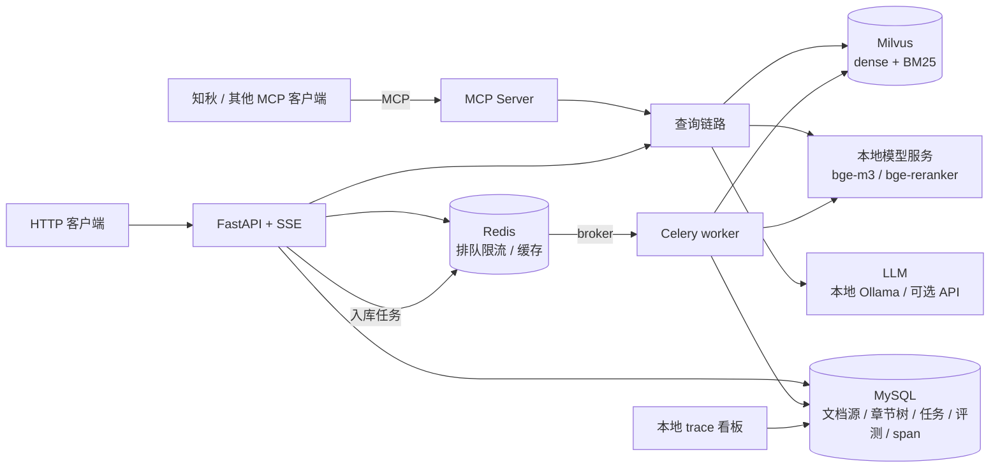

# 文渊（wenyuan）设计文档

> 日期：2026-11-01
> 一句话：面向多用户学习平台的 RAG 服务：**公共技术文档库 + 每个用户的私有资料库**，自带评测闭环和本地 trace 看板，通过 **MCP** 为学习助手知秋提供检索、问答和章节大纲。
> 更新：2026-11-01 晚，W1 跑通后调整：语料改为 DevDocs 为主体；新增私有资料库（理由见 1.2）。
> 更新：2026-11-01 夜，后端定位从“高并发”改为“RAG 服务的后端工程：慢请求、稀缺资源、多用户、数据一致性”（见 1.3）；模型改为本地优先、API 可选（见 3.3）。
> 更新：2026-11-02 深夜，方向调整为课堂学习资料库（CS50 场景），见第 0 节；第 1 节以后描述的是 v0.7。

---

## 0. v2 方向：课堂学习资料库（2026-11-02）

> 本节取代第 1、2 节的定位。第 3 节以后描述的是 v0.7（`git tag v0.7.0`），按本节逐步更新。

### 0.1 为什么调整（复盘）

- **顺序错了**：一开始先挑了语料（官方文档）和评测集（Stack Overflow 题），再倒推产品是什么，结果做成了“另一个文档搜索”，正面撞上联网搜索。
- **定位和实际用法对不上**：部署定位写的是“小团队共享”，实际只在本机自用。Redis、MySQL、Milvus、Celery 都在为一个没有落地的场景服务，本机内存也撑不住：评测期间 Windows 虚拟内存多次耗尽，Docker 被系统杀掉。
- **重心放错**：真正不可替代的是私有资料，评测和优化却都集中在公共文档上（1184 题对 60 题）。
- **正确的顺序**：先定场景，再找能支撑场景的数据，最后按场景选技术栈。

### 0.2 场景

一门课共用的 RAG 服务：老师上传课程资料，作为全班共享的公共库；学生各自上传笔记，只有自己能检索到。问答同时检索两者并标明出处。系统部署在一台带 GPU 的服务器上，全班共用；学生通过网页工作台或自己的学习 Agent（如知秋，经 MCP）使用。

- **为什么不能只靠联网搜索**：课程讲义网上搜不到；答案要和老师讲的、考的保持一致。
- **为什么需要多用户、排队和缓存**：几十个学生共用一块 GPU，作业截止前集中提问；全班同一周学同一章，问题重复度高。

### 0.3 角色

| 角色 | 能做什么 |
| --- | --- |
| 老师 | 创建课程；上传、更新课程资料；给学生发邀请码；查看全班高频问题的汇总（只看汇总，不看个人笔记） |
| 学生 | 上传自己的笔记；提问；看课程目录和章节原文；看自己的 trace |
| 运维 | 部署；查看全站状态（GPU 排队、缓存、压测） |

### 0.4 演示数据与评测

- **课程资料**：哈佛 CS50x 2024，70 篇 Markdown，包括每周讲义、讲课转写、作业和练习，带原始链接和周次。来源是 Hugging Face 上的 `dev-jonathanb/cs50-educational-rag`，许可证 CC BY-NC-SA 4.0；只放在本地（`data/raw/cs50`），不进仓库。
- **学生笔记**：作者自己的算法笔记扮演学生 A；再用 DeepSeek 生成 2～3 位虚拟学生的笔记，用于隔离测试。
- **评测**：
  - **校准集**：CS50 数据集自带的 97 题。题目由模型生成，经人工打分（题目质量 4～5 分）；每题标注出处文件和原文片段，覆盖拼写错误、搜索式、语法不规范等提问风格。
  - **主评测集**：DeepSeek 按课程资料出题，分四类：单节事实、跨周综合、口语化或有错别字的提问、资料里没有的问题。出题模型和检索链路里的本地模型不同。
  - **私有笔记**：DeepSeek 按笔记出题（笔记作者同意为出题发送这批笔记），加上跨用户泄漏测试。
  - v0.7 的官方文档和 SO 题结果作为历史实验保留，不再是主线。

### 0.5 不做

公网上线、对接真实学校系统、PPT 和视频解析（PDF 放到第二阶段）、知识图谱。

### 0.6 怎么算做成了

- 课程资料检索：前 5 条结果里有能回答问题的，比例 ≥ 85%（独立裁判打分）。
- 私有笔记检索：前 5 条命中 ≥ 85%；跨用户泄漏为 0。
- 多人共用：模拟 20 名学生同时提问，0 超时、0 显存溢出。
- 服务器上一条命令部署；开发用的笔记本上有一个能跑得动的轻量模式。

### 0.7 里程碑

| 里程碑 | 内容 |
| --- | --- |
| M1 | CS50 资料入库；课程和角色（老师 / 学生）；老师上传资料、邀请码 |
| M2 | 生成评测集；在新数据上验证 HyDE 和 LLM 重排，决定是否默认开启 |
| M3 | 老师端高频问题汇总；用新数据重做压测 |
| M4 | 文档、演示 |

### 0.8 待定：技术栈

这个场景确实需要多用户隔离、Redis 排队和缓存、异步入库，所以现有架构基本保留（取消了改成 SQLite 单机版的计划）。还要定的：Milvus 是否换成更轻的方案；开发用笔记本上如何避免内存耗尽。

### 0.9 评测集与基线（2026-11-02）

**数据入库**：新集合 `chunks_v2`，BM25 改用 jieba 分词 + 去标点 + 英文转小写（原来的 `standard` 分词器把一整句中文当成一个词，中文笔记的 BM25 等于失效）。CS50 共 70 个文件、1435 个片段；学生 A（作者）的笔记共 124 篇、1153 个片段（只含作者自己写的笔记，不含第三方开源教程）。

**评测集**（都在 `data/eval/`，不进仓库）：

| 评测集 | 题数 | 出题方式 | 标准答案 |
| --- | --- | --- | --- |
| CS50 自带题 | 97 | 模型出题、人工打分 | 出处文件；其中 66 题另有原文片段 |
| 课程生成题 | 238 | DeepSeek 按课程段落出题：换说法 98、中文 80、跨周 60 | 出题所用的段落原文（跨周题两段） |
| 课程无答案题 | 40 | DeepSeek 按课程目录出题，中英各半 | 无，用于拒答测试 |
| 笔记题 | 160 | DeepSeek 按笔记出题：回忆 60、概念 60、混合 40（笔记 + 课程） | 段落原文；检索范围是“课程 + 自己的笔记” |

**证据级指标**：检索到的片段和标准答案的原文有足够重合（连续 5 个词，或 5 个汉字，重合比例 ≥ 0.5）才算命中，和切块方式无关。课程只有 70 个页面，页面级命中率都在 0.9 以上、分不出好坏，所以以证据级为主。

| 前 5 个片段里有证据（ev_hit@5） | 向量 | BM25 | 混合 |
| --- | --- | --- | --- |
| CS50 自带题（66 题有片段） | 0.894 | 0.909 | **0.939** |
| 课程生成题 | **0.794** | 0.567 | 0.748 |
| 　其中中文题 | | | 0.675 |
| 笔记题 | 0.775 | **0.869** | 0.844 |
| 　其中混合题（两段都在前 10 的比例） | | | 0.525 |

- **自带题太容易**：题目照着原文写，和原文用词重合度高，三种方式都在 0.9 左右，只能作参照。
- **没有一种检索方式到处最好**：课程题上向量最好、BM25 最差，因为换说法的题和中文题与英文原文几乎没有共同的词；笔记题上 BM25 最好，因为中文问中文笔记，jieba 分词后能直接对上。混合检索在两边都排第二。
- **最弱的是中文问英文课程（0.675）和需要两段证据的混合题（0.525）**。下一步的查询理解（把中文问题改写成英文检索词）、HyDE、LLM 重排都要在这几类题上验证。
- 目标：课程题和笔记题的证据级命中都 ≥ 85%（0.6 节）。

---

## 1. 背景与目标

### 1.1 为什么这样做
- **目标**：一个每个设计取舍都讲得清的 RAG 服务：检索效果用评测数据说话，后端组件只为真实需求服务。
- **不从零造轮子，也不 fork 整个仓库**：以 LightRAG（HKUDS/LightRAG，4 万 star，MIT，commit `aaebfe1`）为母本剪枝，只拷贝低耦合、读得懂的模块；本地 trace 和 MCP 复用自己的知秋项目。
- **和知秋联动**：知秋是学习助手 Agent（讲解 → 自测 → FSRS 复习 → 学习计划），已有基于官方 MCP SDK 的客户端。本服务作为它的资料后端。
- **数据驱动迭代**：baseline → bad case 归因 → 针对性加模块 → 用指标验证效果，同时说明延迟和成本代价。

### 1.2 为什么要 RAG，而不是联网搜索
- **只基于公开文档，理由偏弱**：Google、带联网搜索的 LLM、Context7 这类文档 MCP 都能查到官方文档。
- **公开文档部分仍然成立的理由**：
  - 锁定学习者正在学的版本，避免不同版本的资料混在一起；
  - 回答必须有出处并经过校验，资料里没有就拒答，因为学习场景里学错比没学更糟；
  - 语料固定，结果可复现，才能做评测和消融；
  - 能提供章节结构，给知秋排学习计划、按章节出题，这是搜索做不到的。
- **真正不可替代的部分是私有资料**：学习者自己的笔记、讲义、电子书、公司内部规范，网上搜不到。所以本服务分两层：
  - **公共库**：官方文档，所有用户共享；
  - **私有库**：用户自己上传的资料，只有本人可见。
  - 检索时两层一起查，并按用户权限过滤。

### 1.3 后端定位：不是高并发，是“单请求重”
- **本项目没有真正的高并发需求**，也不这么宣称。传统高并发（秒杀、IM）是请求又多又轻，瓶颈在连接、数据库和锁；LLM 应用是请求又少又重，每个请求要几秒、占 GPU 或花钱，瓶颈在模型推理。
- 两者用的是同一套工具（缓存、队列、限流），解决的问题不同。本项目的后端工程针对的是：**慢请求、稀缺资源、多用户、数据一致性**。
- **部署方式**（同一套代码）：
  - **个人本地部署**：单用户，配合知秋使用，默认全部用本地模型，不需要任何密钥。
  - **小团队共享部署**（主定位）：学习小组、班级、公司内部培训，几十人共用一台带显卡的机器。此时 GPU 和 LLM 是稀缺资源，排队、限流、缓存才有真实意义。
- 各后端组件的真实理由：

| 组件 | 理由 | 依据 |
|---|---|---|
| Celery 异步入库 | 上万页文档必须异步、并行、可重试；CPU 和 GPU 分队列 | W2 全量入库实测（9943 页，3 次 MySQL 临时报错靠重试恢复） |
| 幂等写入、MySQL 与 Milvus 一致性 | 任务重试和文档更新时不留重复、不留过期数据 | 先删后写、内容哈希 |
| SSE 流式输出 | LLM 生成要几秒，不流式体验差 | — |
| 私有库权限隔离 | 多用户必需 | — |
| 排队、限流 | 共享部署时，一块 GPU 同时只能顺畅生成 2 个回答；API 有调用频率上限和费用 | W3 压测：20 人同时提问，不加闸门时 78% 超时并且 GPU OOM；闸门 + 准入控制后 0 超时、0 OOM，有效吞吐提高到 2.5 倍（见 11.3） |
| 问答缓存（含防击穿） | 重复问题直接返回，省 GPU 和费用 | 10 个并发的相同问题只计算 1 次（单元测试）；真实命中率取决于问题重复度，还没有真实流量 |
| 全链路 trace | 定位慢在哪、错在哪 | 已用于定位 W2 构建卡住的问题 |

### 1.4 目标
| 编号 | 目标 | 可量化标准 |
|---|---|---|
| G1 | 完整入库与检索链路 | 抓取 → 正文提取 → 结构切块 → 章节摘要 → 混合检索 → rerank → 带引用回答，端到端可演示 |
| G2 | 评测闭环 | 真实问题评测集 ≥ 300 条；一条命令跑出检索和生成指标；每个模块都有消融数据 |
| G3 | MCP 对接知秋 | 7 个 MCP 工具；知秋能用文档库生成学习计划、讲课出题、回答提问 |
| G4 | 后端工程 | FastAPI + SSE、MySQL、Redis（排队限流、缓存）、Celery 异步入库，Docker Compose 一键启动；压测给出“一块 GPU 上 N 人同时提问”时排队前后的延迟和超时率 |
| G5 | 可观测 | 本地看板能看到每次请求的 span 树、各阶段延迟、token、成本、缓存命中 |
| G6 | 可信回答 | 论断级引用校验；证据不足时拒答；Agentic 多跳检索有轮数和 token 上限 |
| G7 | 私有资料库 | 用户上传 Markdown / PDF / Notion 资料，检索结果只包含公共库和本人的私有库；权限过滤有测试覆盖 |

### 1.5 本期不做
- 知识图谱（做成可插拔模块，以后参考 LightRAG 的 `extract_entities` 等接入）。
- 定时增量同步、版本感知检索。
- 训练或微调模型；复杂前端。

---

## 2. 使用场景
- **S1 制定学习计划**：用户在知秋里说“我想系统学 Redis 持久化”。知秋调用 `outline(library="redis", topic="持久化")`，拿到章节树和每节摘要，据此拆成每天的知识点。
- **S2 讲课出题**：学到《RDB 持久化》这一天，知秋调用 `search` 取相关段落（带出处），用来讲解和出自测题。
- **S3 学习中提问**：学习者问“RDB 和 AOF 能同时开吗？”，知秋调用 `ask`，返回简洁答案 + 官方文档章节引用；资料里没有就明确说没找到。
- **S4 学新东西**：用户想学一个公共库里没有的框架，提交文档网址；`add_source` 后台异步抓取入库，`source_status` 查进度。
- **S5 用自己的资料学**：用户上传课程讲义或自己的笔记（Markdown、PDF，或知秋已接入的 Notion），入库到私有库。之后讲课、出题、提问会同时用到公共文档和私有资料，引用会注明来自哪一边；其他用户检索不到这些资料。
- **共享部署**：一个班同一周学同一章，几十人共用一块 GPU。问题重复度高，适合缓存；同时提问时要排队和限流，否则所有人的请求一起变慢甚至超时。

---

## 3. 总体架构



### 3.1 技术栈
| 层 | 选型 | 理由 |
|---|---|---|
| Web / API | FastAPI + SSE | 异步、流式输出；和后端学习路线一致 |
| 向量与全文检索 | Milvus 2.5+ | W2 实测约 4.6 万 chunk（18 个库），专用向量库说得过去；原生 BM25 稀疏检索，一个组件搞定混合检索；支持分区和标量过滤 |
| 业务库 | MySQL | 国内最常用；文档源、章节树、任务、评测记录、trace span 都放这里；可以讲 MySQL 和 Milvus 之间的一致性 |
| 缓存 / 限流 / broker | Redis | 一个组件承担三种角色 |
| 异步任务 | Celery | 重试、编排、监控现成；CPU 和 GPU 任务分队列 |
| Embedding / Rerank | bge-m3 + bge-reranker-v2-m3（默认），Qwen3-Embedding + Qwen3-Reranker（对照） | 本地 RTX 5070 Ti 16GB；中英文都好；两组做消融 |
| LLM | 默认本地：Ollama + Qwen3-8B（4-bit）；可选 API：DeepSeek / 通义千问（OpenAI 兼容接口） | 开源后别人无需密钥即可运行；私有资料不出本机；API 用于质量对照和评测打分（见 3.3） |
| MCP | 官方 MCP Python SDK | 与知秋一致 |
| 部署 | Docker Compose（Milvus、MySQL、Redis） + 宿主机 GPU 模型服务 | 50 系显卡需要 CUDA 12.8+，模型服务放宿主机最稳 |

### 3.2 消息队列选型（为什么不用 Kafka / RocketMQ）
| | Redis（Celery broker） | RabbitMQ | RocketMQ | Kafka |
|---|---|---|---|---|
| 定位 | 轻量任务队列 | 通用业务消息 | 业务消息（事务、延迟、顺序、自带重试和死信） | 日志 / 事件流，高吞吐、可回放 |
| 本项目 | ✅ 已经要用 Redis，几乎零成本 | 量大或对可靠性要求更高时升级 | Python 客户端弱，Celery 不支持 | 入库是独立任务，不是事件流；集群太重 |

**升级路径**：任务丢失不可接受时，broker 换成 RabbitMQ；如果接入 webhook 等持续事件流、需要多个下游消费和重放，在入口加 Kafka，Celery 继续执行具体任务。

### 3.3 模型分工：三个本地模型 + 可选 API
| 模型 | 类型 | 作用 | 服务进程 |
|---|---|---|---|
| bge-m3 | 编码模型 | 文本转向量 | `model_server`（sentence-transformers） |
| bge-reranker-v2-m3 | 交叉编码模型 | 给“问题 + 文档”打相关性分 | `model_server` |
| Qwen3-8B（4-bit） | 生成模型 | 查询理解、章节摘要、生成答案 | Ollama（量化、KV 缓存、并发、流式） |

- 不用一个 LLM 包办：LLM 做向量化或 rerank 又慢又不准；编码模型不会生成文字。显存合计约 9GB，16GB 显卡放得下。
- Qwen3-Embedding / Qwen3-Reranker 只在 E7 对比实验时临时加载。
- **LLM 路由规则：凡是涉及私有库的内容，一律用本地模型。**
- **为什么 LLM 经过 Ollama，而不是像 bge 那样自己加载**：
  - **显存**：8B 模型 fp16 权重约 16GB，放不下；Ollama 用 4-bit 量化（约 5GB）。
  - **生成循环**：bge 只做一次前向计算，几十行就能包成服务；生成要逐 token 循环，还要管 KV 缓存、并发槽位、流式输出、停止条件。这是推理引擎的工作，自己写等于重造 llama.cpp。
  - **接口**：Ollama 是 OpenAI 兼容接口，和 DeepSeek 等 API 走同一个客户端，切换只改配置。
  - **隔离**：LLM 爆显存或崩溃不影响 API 进程；空闲时自动卸载，把显存让出来。
  - 生产环境的多卡 Linux 服务器一般用 vLLM（连续批处理，吞吐更高），接口相同。
- **实测要点**（W2）：
  - Qwen3 默认先"思考"再回答，10 个 token 的 JSON 前面会生成约 300 个隐藏 token。Ollama 不认 prompt 里的 `/no_think`，只认 `reasoning_effort: "none"`；加上后查询理解从 6～50s 降到 <1s。
  - 用专用 Ollama 进程，只在该进程内设置 8k 上下文、4 个并发槽位、q8 KV 缓存。默认 4k 上下文放不下回答阶段的 prompt（约 6.3k token）。
  - Windows 上 llama-server 会提交约 17GB 虚拟内存，加上模型服务（约 8GB）和 Docker（约 5GB），16GB 内存的机器提交额度接近用满，评测曾报 MemoryError。批量任务之间要卸载 LLM。
  - **并行槽位设 2，不设 4**（W3 压测）：和 bge-m3 共用 16GB 显卡时，4 路并发生成会显存不足，Ollama 崩溃。服务端的 GPU 闸门也设为 2 槽，两层保护。

| 阶段 | 公共文档 | 私有资料 |
|---|---|---|
| 入库：章节摘要 | 本地，夜间批量（只对教程页做，API 参考页本身结构化） | 本地 |
| 检索前：查询理解 | 本地；API 作对照实验 | 本地 |
| 检索后：生成答案 | API（质量优先，可选） | 本地 |
| 评测打分 | API（裁判要比被评模型强） | API（只发送评测题，不涉及真实私有数据） |

---

## 4. 入库链路
Celery 流水线，按内容 hash 保证幂等；CPU 队列负责抓取、解析、摘要，GPU 队列负责 embedding（并发 = 1，防止显存溢出）。

1. **数据来源**（W1 后调整）：
   - **公共库主体：DevDocs**。844 套技术文档，结构化 HTML，可直接下载，没有导航、多语言代码标签等噪声。选后端相关的十几套（Python、PostgreSQL、SQLite、Django、Flask、FastAPI、Redis、Celery、RabbitMQ、Docker、Kubernetes、Git、Nginx、HTTP、NumPy、pandas、PyTorch 等 16 套）。W2 实测：加上 FastAPI、Redis 共 18 个库、9943 页、约 4.6 万 chunk（估算是 6～10 万，差距来自清洗掉的噪声页，以及 API 参考页普遍很短）。每套文档按其署名要求在 README 注明。
   - **公共库补充：自己的爬虫**。补 DevDocs 缺的教程页（例如 Redis 的数据类型、持久化指南），以及用户通过 `add_source` 提交的网址。遵守 robots.txt，按域名限速；同一网址用 MySQL 唯一键 + 任务状态去重。
   - **私有库**：用户上传的 Markdown、PDF、Notion 页面，走同一条入库流水线，带上 `owner_id`。
   - **清洗流程**（W1 在 Redis 上验证过，每加一个来源都走一遍）：看 URL 分布 → 排除噪声目录（发布说明、归档、其他语言版本）→ 兄弟页面近似重复去重 → 用评测验证效果。
2. **正文提取**：通用正文提取工具 + 按站点配置 CSS 选择器；代码块整块保留。
3. **结构切块**：按标题层级切分，小节为子块、整节为父块；每个子块前加“站点 > 章 > 节”上下文头；章节树写入 MySQL（供 `outline` 使用）。超长小节用固定长度切分兜底。
4. **章节增强**：LLM 为每一节生成摘要和“本节能回答的问题”，和子块一起建索引；摘要同时挂到 `outline` 的章节树上。
5. **Embedding → 写入 Milvus**：dense 向量 + BM25 稀疏字段；按文档库过滤。

---

## 5. 查询链路
1. **查询理解**：一次结构化 LLM 调用，同时输出：多轮改写后的独立问题、API / 函数 / 命令名等关键词（用于 BM25 精确匹配，如 `Depends`、`ZADD`、`EXPLAIN`）、目标文档库及版本、是否需要检索。改造自 LightRAG 的关键词抽取 prompt，并补上它缺的一点：**LightRAG 检索阶段不看对话历史**（`operate.py:4658`），本服务由客户端传入对话历史。
   - **对话历史的来源**：知秋等 Agent 每次请求带上 history，文渊本身无状态（见 5.1）。不想自己管理历史的客户端（例如网页直接调 `/ask`）可以只传 `conversation_id`，文渊从 Redis 取该会话最近 6 轮、用完追加本轮，TTL 2 小时。
   - **查询理解的结果怎么用**（W2 实测）：dense 一侧用改写后的独立问题，它保留了细节，指代也已消解；`candidate_apis` 和关键词只送给 BM25。BM25 靠它们才有用，见 11.2。
2. **混合检索**：同类数据内用 Milvus `hybrid_search`（内置 RRF）；子块和章节摘要 / 问题之间在应用层再做一次 RRF。所有检索都带权限过滤（W3 实现）：`library in [公共库] or (library == "private" and owner_id == 当前用户)`，私有笔记和公共文档在同一个 collection 里。没有用 `owner_id` 作 partition key：partition key 要在建表时指定，改用它就得重建 4.6 万个 chunk；而用户的笔记量很小，标量过滤足够。
3. **Rerank → small-to-big → 截断**：rerank 后子块回溯父块，按 token 预算截断（参考 LightRAG 的 `_apply_token_truncation`）。
   - **rerank 默认关闭**：加了查询理解之后，rerank 显著变差（见 11.2），保留为可选项。
   - **父块逐级回退**：很多页面只有一个 H1，"顶层章节"就是整页（最长 11 万字符）。最初的实现里，排在前面的一个巨型页被截断后独占了全部预算，把有答案的 `FLUSHALL` 页挤了出去，导致错误拒答。现在单块超过 1500 token 就退到命中所在的小节，还太大就只用命中的 chunk。
4. **生成（仅 `ask`）**：简洁答案 + 引用（链接到官方文档的具体章节）；JSON 结构 + SSE 流式；证据不足时拒答。讲解交给知秋。
5. **论断级引用校验**（W4 实现，默认开启）：程序先校验引用的 chunk 是否在本次上下文里，再由一次 LLM 调用逐句判断结论是否被引用的原文支持，不支持的句子删掉（不改写：改写会产生新的、没有校验过的内容）。效果见 11.4。
6. **多跳检索**（W4 实现，见 11.4 的 E9）：默认是**按需拆分**：一次 LLM 调用把问题拆成最多 3 个带目标库的子查询；拆出 2 个以上时，分别检索并按页面轮流交错合并，否则保留第一轮结果。另有**迭代模式**作为可选项：每轮由 LLM 判断还缺什么，再补查一次，最多 3 轮，并设 token 预算上限。

### 5.1 记忆分层：文渊记资料，知秋记人
RAG 常被称为 Agent 的"外部长期记忆"。本项目把记忆按内容拆开，分别放在不同的地方：

| 记忆 | 内容 | 放在哪 |
|---|---|---|
| 公共知识 | 官方文档怎么说 | 文渊 · 公共库 |
| 个人知识 | 用户自己的笔记、讲义 | 文渊 · 私有库（按用户过滤，只走本地模型） |
| 对话记忆（短期） | 最近几轮聊了什么 | 调用方传入；或文渊 Redis 中带 TTL 的 `conversation_id` |
| 学习者记忆 | 学过什么、掌握程度、何时复习 | 知秋 |
| 计算复用 | 同样的问题算过一次 | 文渊 · Redis 问答缓存（不算记忆，文档更新时失效） |

- **对话历史不在文渊长期保存**：会话本来就在 Agent 手里，存两份迟早会不一致；服务无状态才方便扩展；文渊只存资料，不存"人"。
- **指代消解靠查询理解**："小明什么时候上班 → 他下周呢"，第二轮带上历史后改写成"小明下周什么时候上班"，后面各步只用改写结果。
- **不把生成的答案自动写回知识库**：生成内容可能有错，写回后会被当成资料检索出来，越用越不准。用户想保留某个回答，要显式存入私有库，并标注"AI 生成"。

---

## 6. MCP 工具
| 工具 | 输入 | 输出 | 知秋用在哪 |
|---|---|---|---|
| `libraries` | — | 可检索的文档库 | 选库 |
| `search` | question、libraries、history | 带出处的资料片段 | 讲课、出题 |
| `ask` | question、libraries、history | 简洁答案 + 引用（经过论断级校验） | 学习者提问 |
| `outline` | library、topic | 章节树 + 顶层章节摘要 + section_id | 制定学习计划 |
| `get_section` | section_id | 整节原文 | 讲课时取完整章节 |
| `add_note` / `list_notes` | filename、content | 存入 / 列出私有笔记 | 把学习者自己的笔记交给文渊 |

W4 已实现以上 7 个工具（`wenyuan-mcp`，stdio，代理到 HTTP API）。`add_source` / `source_status`（提交新文档站）尚未做。

---

## 7. 后端工程
### 7.1 Redis（目标是保护稀缺资源，不是扛高并发，见 1.3）
已实现（W3），细节和压测数据见 11.3：
- **限流**：按（用户, 接口）分别设令牌桶，Lua 原子执行，超限返回 429 和 `Retry-After`。
- **GPU 闸门**：公平排队的分布式信号量，有每用户上限和租约；准入控制让"预计等不到"的请求立刻得到 busy。
- **问答缓存 + 防击穿**：精确缓存；同一问题并发时只算一次；重新入库时递增库版本号，旧缓存自然失效；有私有笔记的用户使用自己的缓存键。语义缓存暂不做，阈值要先用评测确定。
- **Celery broker**。

### 7.2 MySQL 表（初稿）
`users`、`libraries`（文档库，含 `visibility` 公共 / 私有和 `owner_id`）、`sources`（文档站 / 网址，唯一键去重）、`documents`、`sections`（章节树，含摘要）、`ingest_tasks`、`eval_runs`、`eval_results`、`spans`。已实现：`documents`（W3 加了 `owner_id`）、`sections`、`spans`（W1），`users`（W3，只存 API key 的 SHA-256）。

### 7.3 API
已实现：`POST /v1/ask`（SSE）、`POST /v1/search`、`GET /v1/libraries`、`POST|GET /v1/notes`、`DELETE /v1/notes/{doc_id}`、`GET /healthz`、看板（W3）；`GET /v1/traces`、`GET /v1/traces/{id}`（调用者自己的请求 trace，供工作台的看板标签）；`GET /v1/outline?library=&topic=`、`GET /v1/sections/{doc_id}:{idx}`（W4，供 MCP 的 outline / get_section 使用）。网页工作台 `GET /ui`。
待做：`POST /v1/sources`、`GET /v1/tasks/{id}`（提交新文档站）。

### 7.4 本地 trace 看板（仿照知秋）
- 参考知秋 `src/zhiqiu/tracing.py`：一次请求是一棵 span 树；ContextVar 保存当前 span；开始时写入 running、结束时更新；写入尽力而为，失败不影响主流程；`reconcile` 把进程退出后遗留的 running span 标记为中断。
- 不同点：span 存 **MySQL**（API 和多个 worker 进程都要写）；`trace_id` 通过 Celery 任务头跨进程传递，入库任务也能看到完整链路。
- 看板展示：trace 列表、span 树、各阶段延迟（p50 / p95）、token、成本（参考知秋 `pricing.py`、`prices.py`）、缓存命中率。

---

## 8. 代码复用
| 来源 | 内容 | 方式 |
|---|---|---|
| LightRAG `lightrag/rerank.py` | rerank 调用、按 token 截断 | 拷贝后删到只剩本地模型 |
| LightRAG `lightrag/chunker/token_size.py`、`recursive_character.py` | 固定长度切块（baseline）、超长小节兜底 | 拷贝，替换 `lightrag.utils` 依赖 |
| LightRAG `lightrag/prompt.py` | `keywords_extraction`、`rag_response` 等 | 拷贝后大改：合并多轮改写和路由，换成文档学习场景 |
| LightRAG `operate.py` 的 `_apply_token_truncation`、`_build_context_str` | token 预算、上下文拼装 | 读懂后重写精简版 |
| 知秋 `tracing.py`、`traces.py`、`dashboard.py`、`pricing.py`、`prices.py` | trace、看板、成本 | 改造复用（SQLite 换成 MySQL） |
| 知秋 `mcp_server.py` | MCP Server 写法 | 参考 |
| 不碰 | LightRAG 的 `lightrag.py`、`pipeline.py`、`kg/*`、`parser/*`、`api/`、WebUI | — |

**协议**：拷入的 LightRAG 文件保留 MIT 声明（`third_party/LICENSES/LightRAG-MIT.txt`），文件头写明来源路径、commit 和修改说明，README 加 Acknowledgements。只拷读懂了的代码。

---

## 9. 评测
### 9.1 评测集
- **公共库主评测**：Stack Overflow 上**采纳答案链接了官方文档**的问题。问题是真实学习者提的，链接到的页面就是检索的标准答案（CC BY-SA）。语料换成 DevDocs 后，标准答案按路径映射到 DevDocs 条目；标签扩展到 python、django、docker、postgresql 等。
- **标注审核**：审核结果单独存放（`so_v1_audit.jsonl`），分为可回答 / 部分可回答 / 不适用，并标注“内容已搬家”的过期题。评测默认排除不适用，并按标签分组报告。
- **私有库评测**：用作者自己的学习笔记作私有库，人工写 30～50 道题，同时验证权限：其他用户检索不到这些笔记。
- **多跳评测**：用公开多跳问答集 HotpotQA 的子集测 Agentic 多跳，补足自有数据里多跳题少的问题。
- **补充**：用**另一个模型**合成多轮题和无答案题；合成题和真实题分开报告。
- **防泄漏**：索引里有 LLM 生成的“本节能回答的问题”，所以评测题不能用同一种方式生成。
- **可复现**：评测用的查询向量统一缓存。fp16 推理会按 batch 补齐长度，同一段文本在不同 batch 里向量不同，曾导致同一实验两次跑分相差约 0.01。

### 9.2 指标
| 层 | 指标 |
|---|---|
| 检索 | Recall@5/10、MRR、nDCG@10 |
| 生成 | 答案正确率（LLM-judge）、忠实度、引用正确率、拒答准确率 |
| 系统 | p50 / p95 延迟、单次成本、缓存命中率 |
| 压测 | 一块 GPU 上 N 个用户同时提问（N = 1、5、10、20）：不排队和排队 + 限流两种情况下的 p95 延迟、超时率、吞吐 |

### 9.3 消融实验
| 实验 | 变量 |
|---|---|
| E0 | 固定长度切块 + 纯向量（baseline） |
| E1 | + 结构切块 + 父子块 |
| E2 | + BM25 + RRF |
| E3 | + rerank |
| E4 | + 上下文头 |
| E5 | + 章节摘要 / 问题索引 |
| E6 | + 查询理解。单轮：SO 全集；多轮：把一道 SO 题拆成"先问 A、再用'它 / 那个'追问 B"的合成两轮题，对比带历史与不带历史的召回 |
| E7 | BGE 对比 Qwen3 |
| E8 | + 论断级引用校验 |
| E9 | + Agentic 多跳（多跳子集） |

每组按题型拆分报告。一条命令跑完：`python -m eval.run --exp <配置>`，结果写入 `experiments/` 和 MySQL；CI 中设评测门禁。

---

## 10. 目录结构（规划）
```
RAG项目/
├── app/
│   ├── api/          # FastAPI 路由、SSE、看板
│   ├── ingest/       # 抓取、正文提取、结构切块、章节摘要
│   ├── retrieval/    # Milvus 检索、RRF、rerank、上下文组装
│   ├── query/        # 查询理解
│   ├── generation/   # 答案生成、引用校验
│   ├── agent/        # Agentic 多跳
│   ├── cache/        # Redis 缓存、防击穿、限流
│   ├── tracing/      # span、trace 查询
│   ├── workers/      # Celery 任务
│   ├── models/       # embedding / rerank / LLM 客户端
│   ├── db/           # MySQL 模型与迁移
│   └── config.py
├── mcp_server/
├── model_server/     # 宿主机 GPU 模型服务
├── eval/
├── experiments/
├── third_party/LICENSES/
├── tests/
└── docker-compose.yml
```

---

## 11. 实验结论
### 11.1 W1（2026-11-01）
- **链路**：抓取 → 正文提取 → 分节 → 切块 → bge-m3 → Milvus → 评测，已跑通；trace 写入 MySQL。
- **语料**：FastAPI + Redis 清洗后共 920 页，只有约 5000～5800 个 chunk，撑不起专用向量库，因此改用 DevDocs 扩充。
- **噪声**：Redis 约一半抓取页是噪声（企业版、发布说明、9 种语言重复的用例和客户端文档），已排除 449 页、去重 3 页。
- **实验**（纯向量，217 题，排除不适用）：

| 方案 | 整体 Recall@5 | FastAPI | Redis |
|---|---|---|---|
| E0 固定 512 token | 0.352 | 0.366 | 0.316 |
| E1b 按小节 + 合并短小节 | **0.383** | **0.391** | **0.363** |

  清洗之前，按小节切块在 Redis 上更差；清洗并排除坏标注之后，两个库都领先。之前的结论是噪声造成的假象。
- **主要失败类型**：用意图找命令（“删除所有数据”→ FLUSHALL），问题里没有命令名。对症的是查询理解（E6）和 BM25（E2）。

### 11.2 W2（2026-11-01）
- **语料**：18 个库、9943 页、46,443 个 chunk（DevDocs 16 套 + FastAPI、Redis 官网）。
- **评测**：1184 道 SO 题（排除人工标为“不适用”的题）。页面级指标，显著性用配对 bootstrap 95% 置信区间（`python -m eval.compare A.json B.json`）。

| 方案 | Recall@5 | Recall@10 | MRR | 检索延迟 p50 |
|---|---|---|---|---|
| E1 纯向量（按小节 + 合并短小节） | 0.483 | 0.587 | 0.391 | 5 ms |
| E2 + BM25（RRF） | 0.467 | 0.584 | 0.375 | 5 ms |
| E3 E2 + rerank 前 50 | 0.490 | 0.617 | 0.390 | 437 ms |
| E6 纯向量 + 查询理解 | 0.475 | 0.574 | 0.393 | 5 ms |
| E6 混合 + 查询理解 | 0.527 | 0.649 | 0.442 | 5 ms |
| **E6 混合 + 查询理解，dense 用原问题** | **0.531** | **0.660** | **0.444** | 4 ms |
| E6 上一行 + rerank 前 50 | 0.507 | 0.643 | 0.407 | 438 ms |

查询理解另需一次 LLM 调用：本地 Qwen3-8B 约 0.8s。

- **查询理解是最大的单项提升**：混合 + 查询理解相对 E3，四个指标都显著提升（Recall@5 +3.7，MRR +5.2），而且不需要 rerank 的 430ms。机制正是 W1 的失败分析：问题里很少出现 API 名，原始 BM25 抓不到关键词（E2 甚至显著变差）；LLM 补出 `FLUSHALL`、`dropna`、`EXPLAIN` 之后，BM25 才起作用。
- **改写对 dense 没帮助**：纯向量 + 查询理解与 E1 没有显著差异。短英文改写丢掉了原问题正文里的报错和代码；dense 用原问题、BM25 用 LLM 关键词，两边各取所长。
- **有了查询理解之后，rerank 变成负收益**：Recall@5 −2.4、MRR −3.7（显著），FastAPI 从 0.40 降到 0.30。和 E3 中观察到的"reranker 偏爱 API 参考页"一致。默认关闭 rerank。
- **端到端 `ask`**：抽查中英文题目，修了两个让正确答案变成拒答的问题：①巨型父块独占上下文预算（改成父块逐级回退，见第 5 节第 3 步）；②Qwen3-8B 用中文回答时，常常只在 `citations` 字段里给来源、正文不写 [S#]，引用校验只认行内标记（改成两处合并校验，不存在的编号仍然丢弃）。
- **E5 章节摘要：负结果，默认关闭**。对 3076 个教程页父块生成摘要和 3～5 个"学习者会怎么问"（本地 Qwen3-8B，约 40 分钟，0 失败），共 18,397 行，存入单独的 collection，与 chunk 结果做 RRF。

  | 在"混合 + 查询理解"上 | Recall@5 | MRR |
  |---|---|---|
  | 不加摘要 | 0.531 | 0.444 |
  | + 摘要，RRF 权重 1.0 | 0.474 | 0.419 |
  | + 摘要，RRF 权重 0.6 | 0.531 | 0.444 |

  - **挤占效应**：摘要只覆盖教程页。融合后前 5 名里教程页的占比从 62% 升到 80%，标准答案是 API 参考页的 435 道题，Recall@5 从 0.546 跌到 0.433。
  - **该受益的地方也没受益**：标准答案是教程页的 663 道题，0.527 → 0.513。降权最多做到"无害"：权重 0.6 时摘要只能排到第 40 名以后，结果与不加相同。权重 0.3 时则一条都进不了前 50（chunk 列表第 50 名的 RRF 分数是 1/110，摘要第 1 名乘以 0.3 后只有 0.3/61）。调权重之前要先算清 RRF 的分数范围。
  - **适用边界**：SO 题是带正文、代码、报错的长问题，dense 已经能利用这些信息。"学习者会怎么问"索引更可能帮到短的口语化问题（知秋的典型输入），现有评测集测不到，等多轮 / 口语子集建好后再测。
  - 摘要不浪费：`outline` 工具把它挂在章节树上，供知秋制定学习计划。

### 11.3 W3（2026-11-02）：服务化与共享部署
- **HTTP API**：`POST /v1/search`（只返回带出处的片段）、`POST /v1/ask`（默认 SSE）、`/v1/notes`（私有笔记的增、查、删）、`/v1/libraries`；API key 认证，数据库只存 key 的 SHA-256。
  - **SSE 推送的是阶段事件，不是逐字 token**：`queued`（排队位置）→ `understanding` → `sources` → `done`。答案要先经过引用校验（假引用删掉，没有有效引用就拒答），逐字推送会让学习者先看到之后又被撤回的句子。热启动时约 1 s 出现来源，3～4 s 出现答案。
  - 查询链路是同步代码（httpx、pymilvus、SQLAlchemy），每个请求在线程里执行，通过队列把事件交回事件循环；线程复制请求的 context，所以 span 都挂在同一个 trace 下。
- **Redis 守卫**（顺序：限流 → 缓存 → GPU 闸门）：
  - **限流**：按（用户, 接口）分别设令牌桶，Lua 脚本原子执行，时间取 Redis 的 `TIME`，避免多个 API 实例时钟不一致；超限返回 429 和 `Retry-After`。
  - **GPU 闸门**：分布式公平信号量，用 Lua 加 ZSET 实现。同时运行的请求数不超过 `slots`，每个用户最多占 `per_user` 个；其余请求按到达顺序排队，已达上限的用户会被跳过，不挡后面的人。槽位是租约，进程崩溃后会过期；放弃排队的请求会被清出队列。
  - **准入控制**：记录"占用一个槽位的平均时长"（EWMA）。排在第 k 位的请求预计要等 k × 平均时长 ÷ slots；如果已经超过等待上限，立刻返回 busy，并把预计等待时间放进 `Retry-After`。
  - **问答缓存 + 防击穿**：键由规范化的问题、文档库、对话历史和各库的版本号组成；重新入库时版本号加 1，旧条目自然失效，不用逐条删除。同一个问题并发到达时，只有第一个请求去计算，其余请求等它的结果，不占 GPU；第一个请求失败时，等待者自己接手。只做精确匹配：语义缓存需要用评测确定阈值，否则会误命中。
- **私有库**：笔记写在同一个 collection 里，`library = "private"`，带 `owner_id`。Milvus 的 `add_collection_field` 可以原地加字段，4.6 万个已有 chunk 不用重建索引。
  - **所有检索都经过 `scope_filter`**：`library in [公共库] or (library == "private" and owner_id == 当前用户)`。客户端传来的公共库列表里如果有 `"private"`，会被剔除，所以别人的笔记只能通过 owner 条件匹配。在真实 Milvus 上测过 dense、BM25、hybrid 三种检索和五种参数组合，都看不到他人的笔记。
  - **缓存隔离（修复了一个隐私漏洞）**：原来的缓存键不区分用户，A 基于自己笔记得到的答案，B 问同一个问题时可能直接命中。现在上传过笔记的用户，缓存键里会带上他自己的私有库版本号；没有笔记的用户仍然共享公共缓存。
  - **路由**：上下文里只要出现私有来源，就用 `local_llm` 生成答案；trace 里记录 `private_context` 和 `answer_model`。
- **看板**（工作台的「看板」标签，`/v1/traces`）：**每个用户只看得到自己的请求**。trace 里有提问内容和模型对它的理解，多用户共享时不能互相可见：按根 span 上的 `user_id` 筛选，别人的 trace 编号返回 404（和不存在一样，不暴露它是否存在）。GPU 闸门只显示占用了几个槽位，不显示是谁。全站视图 `/dashboard/api` 只留给运维（压测脚本用），只允许本机访问，页面上不再链接。只读，展示最近的请求、各阶段耗时、排队时间、p50/p95、缓存命中率和闸门占用，点开某个请求可以看 span 瀑布图。
- **网页工作台**（`/ui`）：给不想用命令行的学习者，和其他客户端一样只调 `/v1` 接口（问答走 SSE，阶段实时显示；笔记上传、删除；按主题看章节树、点开全文），trace 看板也合并进来作为一个标签，只显示自己的请求。浏览器可以记住多个账号并在右上角切换（`GET /v1/me` 取账号名）。第一次打开时可以起名建号，但这个接口和看板一样只允许本机访问，共享部署时仍由管理员发 key。`scripts/wenyuan.ps1` 按依赖顺序拉起 Docker、模型服务、专用 Ollama 和 API，已在运行的部分跳过。

**压测**（`python -m eval.loadtest`）：N 个独立用户，每人连续问 3 个不同的真实 SO 问题；客户端 30 s 超时；每轮开始前让缓存失效。Ollama 并行数 2，一块 RTX 5070 Ti 16GB，同时运行 bge-m3 模型服务。

| 20 人同时提问（60 个请求） | 不加闸门 | 闸门 2 槽 + 准入控制 |
|---|---|---|
| 成功 | 13 | **19** |
| 超时 | **47（78%）** | **0** |
| 快速拒绝（busy） | 0 | 41，中位数 0.11 s 返回 |
| 有效吞吐（在超时内完成的答案） | 8.7 个/分钟 | **21.9 个/分钟** |
| 首个事件 p95 | 27.9 s | **0.21 s** |
| GPU OOM | 2 次（Ollama 崩溃、重新加载） | **0** |
| 压测结束时仍在运行的请求 | 14 个（客户端早已放弃） | 0 |

- **不加闸门时，过载会导致拥塞崩溃**：客户端已经放弃的请求仍在占用 GPU，后面的请求也跟着超时，有效吞吐从 10 人时的 26 个/分钟跌到 8.7 个/分钟。闸门把超出能力的请求挡在 GPU 之外，而且立刻告诉客户端。
- **取舍**：10 人时，不加闸门的一组 30 个请求全部完成（p95 25 s，已接近 30 s 的超时线）；加闸门的一组拒绝了 9 个。20 s 的等待上限偏保守，这是"快速失败"和"尽量服务"之间的一个可调参数。
- **槽位数要按实测设置，不能照抄推理服务的配置**：Ollama 设 4 个并行槽位时，4 路并发生成会让 16GB 显卡 OOM，Ollama 崩溃，正在处理的请求全部失败。改为闸门 2 槽、Ollama 并行数 2 后，压测期间 0 次 OOM。不加闸门时，即使 Ollama 并行数是 2 也会 OOM：大量请求堆在 Ollama 内部队列里，llama-server 频繁切换各请求的 prompt 状态，临时显存分配失败。
- **压测找到的 4 个 bug**（单用户测试都发现不了）：
  1. 每个请求新建一个 MilvusClient（一条新的 gRPC 连接），并发时被 Docker 端口转发拒绝 → 每个进程共用一个客户端。
  2. Redis 连接在突发请求下一次开出太多，`localhost` 还会先试 IPv6 → 改用有上限的阻塞连接池，地址改为 `127.0.0.1`。
  3. 客户端断开时，Starlette 会取消流式响应，`finally` 里的 `await ticket.release()` 也被取消，槽位一直泄漏到租约过期（两个超时请求让整个闸门被占了好几分钟）→ 释放操作放进 `anyio.CancelScope(shield=True)`，并用"模拟真实网络让出事件循环"的测试复现。
  4. API 每个请求都新建 LLM 客户端，并且读取评测用的磁盘缓存 → 进程内共享客户端；线上服务不使用评测缓存。

### 11.4 W4（2026-11-02）：MCP、论断级校验、多轮评测
- **MCP 服务**（`wenyuan-mcp`，stdio）：作为 HTTP API 的薄代理。限流、GPU 闸门、缓存和私有库隔离对 MCP 调用同样生效，MCP 不会成为绕过保护的后门。
  - **7 个工具**：`libraries`、`search`、`ask`、`outline`、`get_section`、`add_note`、`list_notes`。
  - **输出**：紧凑的中文纯文本，每段都带出处链接，控制在 5500 字符以内。知秋会把工具输出当作一份资料，默认上限是 6000 字符。
  - **错误**：繁忙、限流、没找到都转成模型能看懂的提示，并附上建议的重试时间。
  - **验证方式**：用知秋自己的 `McpClientPool` 以 stdio 子进程方式连接（没有改知秋的代码），7 个工具全部可调用。配置示例见 `examples/koyo-mcp.json`，只读工具在知秋里设为 `network` 权限：知秋准备资料时只会从 `network` / `external_mcp` 类工具获取外部资料，这类调用还会经过它的隐私泄漏检查；写操作 `add_note` 设为 `external_mcp`，每次需用户批准。最初设成 `read`，结果准备资料时不会用到文渊。配置文件要放在知秋能读到的普通目录（如 D 盘项目下被 gitignore 的 `.cache/koyo/`）：最初放在一个由开发沙箱创建的 `%APPDATA%\zhiqiu` 目录里，沙箱内外的读取测试都通过，但从桌面快捷方式启动的知秋就是读不到，挪到 D 盘后正常。
- **`outline` 的主题定位**：最初只用 dense 检索，"持久化"排第一的是 `PERSIST` 命令页，持久化指南连前 14 名都没进。改为和 `ask` 一样先做查询理解再做混合检索，并把主题包装成学习目标（"我想系统学习 Redis 的「持久化」"），教程页排在参考页前面。改完后排第一的是 Redis persistence 指南，顶层章节挂上了 E5 生成的摘要。
- **E8 论断级引用校验**：把答案拆成句子，每句带上它引用的来源；一次 LLM 调用逐句判断"引用的原文是否支持这句话"，删掉不支持的句子，全部删光就拒答。拆句时，代码里的点号（如 `df.dropna()`）不算句号。

  | 100 道 SO 题，裁判 DeepSeek（独立于被评的 Qwen3-8B） | 校验前 | 校验后 |
  |---|---|---|
  | 不受原文支持的论断占比 | 23.4% | **10.3%** |
  | 含不受支持论断的答案占比 | 47.8% | **23.0%**（−26 个百分点，CI [−36, −17]） |
  | 完全正确（对照 SO 采纳答案，2 分） | 44% | 44%（差值 0，CI [−5, +6]） |
  | 给出答案的题数 | 92 | 87 |

  - 删除的精确率 64%，召回率 67%：删掉的句子里约 2/3 确实不受支持，不受支持的句子里约 2/3 被删掉了。
  - 新增的 5 个拒答，在校验前没有一个是完全正确的（评分 1、1、0、1、0）。
  - 校验器未命中缓存时的耗时 p50 为 846 ms，最长 2.2 s。
  - **结论**：默认开启。学习场景里学错比没学更糟，用不到 1 秒的代价换来"含错答案减半"，而且正确率没有损失。
  - **裁判**：先试过本地 Qwen3 开启思考模式当裁判，但它和被评的是同一个模型，而且每题要 30 秒以上；最终改用 DeepSeek，通过 `JUDGE_*` 配置。
- **E6 多轮子集**：把 199 道 SO 题改写成两轮对话。第一轮引入话题，第二轮的追问把**最具体的技术对象**换成"它 / 那个"。改写由 DeepSeek 完成，和负责消解指代的本地模型不同。第一版 prompt 生成的题里，71/200 只隐藏了库名，可评测时本来就会告诉检索器是哪个库，这些题测不出任何东西；改 prompt 并加了过滤之后才有效。

  | 199 道两轮对话 | Recall@5 | MRR |
  |---|---|---|
  | 原问题（上限） | 0.543 | 0.446 |
  | 只有追问，不给历史 | 0.215 | 0.182 |
  | 追问 + 历史（文渊的做法） | **0.488** | **0.395** |

  - 没有历史时召回率不到一半；带上历史后显著回升（Recall@5 +27.3，CI [+21.3, +33.5]），收回了 83% 的损失。
  - 离上限还差 5.5 个点（Recall@5 的差距不显著，MRR 的差距显著）。剩下的失败题大多是对话本身就有歧义，例如第一轮问"什么是 tensor"，追问"how do I get it"。
- **健壮性**（评测中发现）：
  - Ollama 偶尔返回 500：LLM 客户端对 5xx 和网络错误重试一次。
  - 模型在 JSON 模式下陷入重复循环（`token repeat limit reached`）：温度为 0 时每次都会重现，所以改用采样加频率惩罚重试两次，仍然失败就抛出明确的 `LLMError`。
  - 评测按题记录错误，不会因为一道题失败而整轮作废。
- **CI 与评测门禁**：GitHub Actions 每次 push 跑单元测试。完整评测需要 GPU、语料和本地模型，托管 CI 跑不了，所以另做了发版前的回归门禁 `python -m eval.gate <新一轮评测>`：和 `eval/baselines.json` 里的基线逐题做配对 bootstrap，任何指标的 95% 置信区间整体落在 0 以下就失败，退出码为 1。门禁拦下过一次真实的回归，见下面 E9。
- **E9 多跳检索（跨库问题）**：评测集由 DeepSeek 生成。从 12 组常一起用的库（FastAPI+Redis、Django+PostgreSQL、Celery+RabbitMQ 等）里，取 A 库一个教程章节和 B 库中与它最相关的章节，让 DeepSeek 写一个必须同时用到两段才能回答的问题；组合不自然的就跳过。120 次尝试得到 66 题，标准答案是两个页面。

  | 66 道跨库题 | 两页都在前 5 | 两页都在前 10 | 多出的 LLM 调用 |
  |---|---|---|---|
  | 单次检索 | 0.182 | 0.303 | 0 |
  | **拆分（decompose）** | **0.303** | **0.455**（+15.2，CI [+3.0, +27.3]） | 1 |
  | 迭代（检索 → 判断缺什么 → 补查，最多 3 轮） | 0.288 | 0.409 | 约 2 |

  - **合并方式比策略本身更关键**：最初用 chunk 级 RRF 合并各子查询的结果，拆分和迭代**都比单次检索差**（两页都在前 10 的比例：0.29 和 0.17）。原因是章节多的页面在每个列表里都有命中，累计得分最高，把"某个子查询排第一、但只出现在一个列表里"的页面压了下去。各子查询前 5 名的并集里，两页都在的比例有 0.49，说明子查询本身找到了。改为**按页面轮流交错**（每个子查询依次贡献一个页面）后，拆分从 0.29 升到 0.45。
  - **门禁拦下的回归**：如果每个问题都拆，1184 道单跳 SO 题的 Recall@5 会显著下降 2.0 个点（CI [−3.9, −0.1]），门禁不通过。原因是单跳问题往往只拆出 1 个子查询，它和第一轮结果交错，反而打乱了原有排序。改为**按需拆分**：拆出的子查询少于 2 个时保留第一轮结果。改完后单跳 Recall@5 为 0.534 对 0.532，门禁通过；跨库题仍是 0.455。
  - **结论**：`ask` 默认开启按需拆分（`AskConfig.multihop = "decompose"`），每个问题多 1 次 LLM 调用。迭代模式效果不如拆分，成本却是拆分的两倍，保留为可选项。迭代模式还修了一个问题：模型会重复生成已经查过的查询，现在遇到重复就停止。

- **E7 BGE-m3 对比 Qwen3-Embedding-0.6B（只换向量模型）**：用 Qwen3 重新计算 46,443 个 chunk 的向量（`python -m app.ingest.reembed`，10.6 分钟），写入新 collection。文本、切块、BM25 字段全部相同。查询使用 Qwen3 自带的 query 指令前缀，文档不加前缀。两个模型参数量相当（0.6B 对 568M）。

  | 评测集 | 设置 | BGE-m3 | Qwen3 | 差值 |
  |---|---|---|---|---|
  | SO 真实问题（1184） | 纯向量 Recall@5 | 0.483 | **0.601** | **+11.8**（CI [+9.5, +14.1]） |
  | SO 真实问题 | 最佳配置 Recall@5 | 0.531 | 0.603 | +7.2（显著） |
  | DeepSeek 写的多轮题（199） | 追问 + 历史 Recall@5 | 0.488 | 0.513 | +2.5（不显著） |
  | DeepSeek 写的跨库题（66） | 单次检索 Recall@10 | 0.652 | 0.583 | **−6.8**（CI [−12.1, −1.5]） |
  | DeepSeek 写的跨库题 | 拆分 Recall@10 | 0.689 | 0.720 | +3.0（不显著） |

  - **结论：默认仍用 BGE-m3**。Qwen3 在 SO 上大幅领先，但在两个**独立生成**的评测集上，一个没有显著差异，一个显著更差。最可能的原因是**评测集污染**：Qwen3-Embedding 的训练数据很可能包含 Stack Overflow 问答，相当于"见过考题"。另一个可能的因素是 SO 题偏长、夹杂代码和报错，这类文本正好是 Qwen3 的强项。两种解释都意味着 SO 上的提升不能直接当作真实收益。
  - **教训**：只看一个评测集，会得出"换模型涨 12 个点"的错误结论。凡是用公开数据构建的评测集，都要用训练数据里不可能出现的题目交叉验证。
  - 换上 Qwen3 后，查询理解 + BM25 在 SO 上几乎不再有增益（0.601 → 0.603，不显著）。在 BGE 上它带来 +4.8，说明这一步补的正是 BGE 不擅长匹配的 API 名。
  - Qwen3 可以通过配置使用（`reembed` 加评测的 `--embed-model` / `--query-prompt`），模型服务支持按请求指定 `prompt_name`。

- **私有库评测**（`python -m eval.private_eval`）：用作者自己的 6 篇学习笔记（Notion 导出：RAG 费曼复盘、HTTP / FastAPI、数据库、Redis、SSE、消息队列）建私有库，由**本地 Qwen3** 按小节出题，共 60 题。笔记内容遵守路由规则，不发给外部 API；代价是出题和答题的是同一个模型，结果可能偏乐观。笔记、题目和逐题结果只存在 gitignore 排除的 `.cache/private_eval/`，仓库里只有汇总分数。

  | 60 题 | 结果 |
  |---|---|
  | 笔记主人：自己的笔记在前 5 名 | 86.7%（MRR 0.737） |
  | 笔记主人：私有内容进入回答上下文（因而走本地模型） | 93.3% |
  | **另一个用户问同样的问题：检索到的私有内容** | **0 条** |

  - 没命中的 8 题，问的都是公共文档里也有的知识（例如"FastAPI 参数校验失败返回什么状态码"），官方文档排在笔记前面是合理的。记录个人理解和错题为主的两篇笔记（数据库、RAG 费曼复盘）全部命中。

## 12. 里程碑（从 2026-11-03 开始）
| 周 | 交付 |
|---|---|
| W1 | 项目骨架 + Docker Compose + GPU 模型服务；抓取 2～3 个文档站，结构切块 + 纯向量 baseline；Stack Overflow 评测集首批 100 条；跑出 E0；trace 骨架 |
| W2 | DevDocs 公共库入库（Celery 流水线），评测集映射到 DevDocs 并扩展标签；章节摘要；BM25 + RRF + rerank；查询理解；`ask` 带引用；E2～E6 |
| W3 | ✅ FastAPI + SSE；Redis 排队限流、缓存；Ollama 本地模型与 LLM 路由；压测；私有库（上传入库、按用户权限过滤）；本地 trace 看板。MCP Server、知秋接入、私有评测题顺延到 W4 |
| W4 | ✅ MCP Server（7 个工具，经知秋的 MCP 客户端验证）；论断级引用校验（E8）；多轮评测子集（E6）；多跳检索（E9，按需拆分）；CI + 评测回归门禁；BGE 对比 Qwen3（E7）。私有库评测（60 题，跨用户泄漏 0）。尚未完成：知秋里的端到端对话演示 |

每周最低标准：评测脚本能跑通，`experiments/` 里有新的实验记录。

---

## 13. 风险与应对
| 风险 | 应对 |
|---|---|
| 时间不够 | 严格按里程碑推进；W4 可以延后，W1～W2 的评测闭环必须完成 |
| 50 系显卡环境问题 | 模型服务放宿主机，用支持 CUDA 12.8 的 PyTorch；不行就先用 API |
| 文档站反爬或结构差异 | 遵守 robots.txt、限速；按站点配置选择器；个别站点用官方提供的离线文档包 |
| Stack Overflow 题量不够 | 放宽标签范围；合成题补齐，分开报告 |
| LLM 成本 | 评测结果缓存；开发阶段用便宜模型，最终报告用正式模型 |
| 项目变成“堆技术” | 每个模块都要有消融数据，没有数据支撑的模块不作为结论 |
